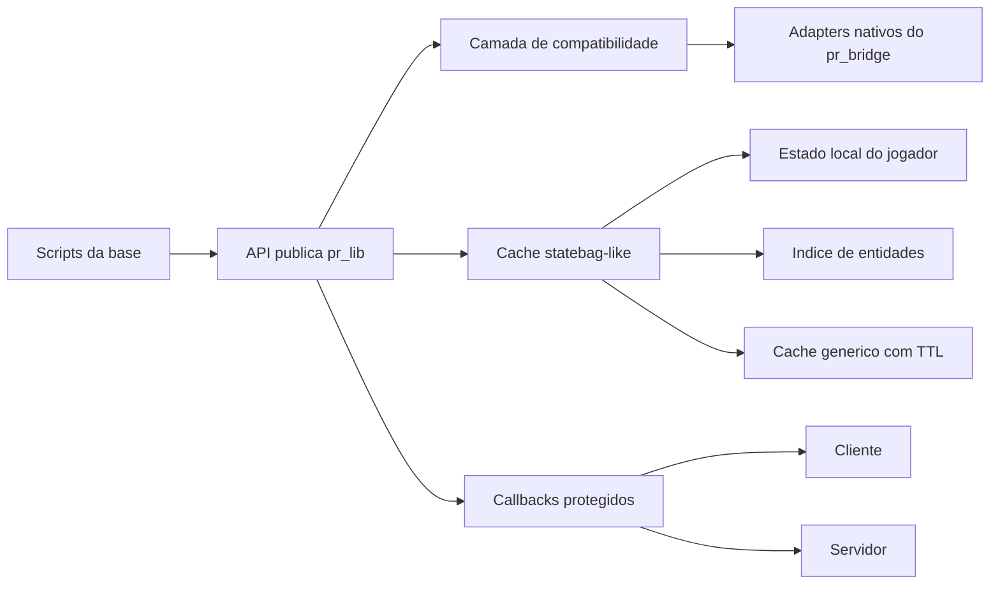
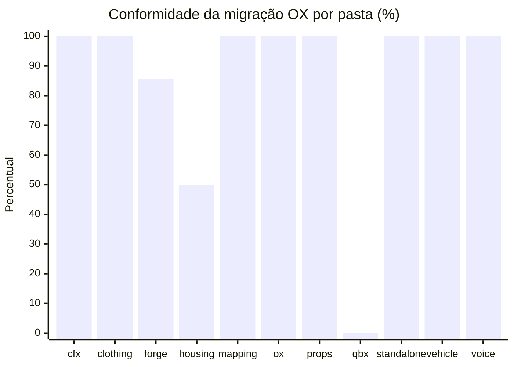
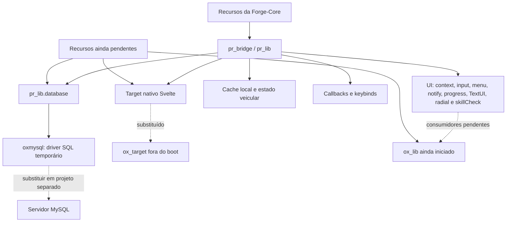

> Histórico preservado em 01/10/2026. Não usar os percentuais/checklists abaixo como fotografia atual. Consulte OX_LIB_MIGRATION_PLAN.md.

# Plano de compatibilidade ox_lib -> pr_bridge

## Objetivo e limites

Este documento acompanha a evolução do `pr_bridge` como camada central da Forge-Core e o avanço das migrações que removem dependências diretas de `ox_lib`, `ox_target`, `oxmysql` e bridges particulares dos recursos.

- Escopo acompanhado: núcleo do `pr_bridge`, compatibilidade pública, recursos já migrados, pendências reais e homologação controlada.
- Autoridade por domínio: o `qbx_core` responde transitoriamente pelos domínios ainda não migrados; o `forge-core` assumirá o framework gradualmente. O `pr_bridge` centraliza dados, cache, comunicação e acesso à persistência, preservando um único responsável por escrita em cada domínio.
- Regra de compatibilidade: preservar as APIs públicas existentes do `pr_bridge` e acrescentar aliases compatíveis sem exigir migração imediata.
- Regra de desempenho: nenhum cache automático deve varrer todas as entidades a cada frame.
- Regra de segurança: callbacks devem validar origem, expirar solicitações e limitar filas pendentes.

## Direção vigente — 2026-09-16

A [Visão de arquitetura da Forge-Core](FORGE_CORE_VISION.md) registra a direção definida pelo proprietário: `pr_bridge` como biblioteca central de dados, cache e comunicação; `forge-core` como framework definitivo; retirada gradual do `qbx_core`. Cálculos contínuos de necessidades ficam no cliente, consumíveis aproveitam o fluxo do inventário para atualizar o cache do servidor e persistência usa checkpoints escalonados e eventos de sessão.

A direção é manter state bags para replicação veicular e migrar os demais usos para cache e contratos explícitos do bridge. Isso não certifica a retirada de todos os usos atuais. As passagens históricas sobre autoridade permanente do QBX ou cálculo de status no servidor ficam superadas pela visão vigente. Checklists históricos permanecem como evidência do trabalho da época; nenhum item de implementação é concluído por esta atualização documental.

## Visão da arquitetura



## Estados

- `[ ]` pendente
- `[~]` parcialmente concluído; resta implementação ou validação
- `[!]` parcialmente concluído, mas depende de decisão, recurso externo ou teste controlado
- `[X]` concluído e validado

**QA (Quality Assurance / garantia de qualidade):** testes funcionais executados dentro do FiveM para confirmar que a implementação validada no código também funciona no servidor real. Inclui fluxos completos, permissões, interface, reconnect, restart, persistência e integração entre recursos.

## Reauditoria integral OX — 2026-09-14

Esta seção é a fotografia autoritativa mais recente da base e substitui as
contagens das auditorias de 2026-08-19 e 2026-09-03. As seções antigas continuam
no documento como histórico, mas não devem ser usadas para medir o progresso atual.

### Direção confirmada

- `ox_lib` deve ser integralmente removido do produto. Nenhum consumidor poderá
  importar `@ox_lib/init.lua`, declarar `ox_lib`, chamar seus eventos/exports ou
  depender de um objeto `lib` fornecido pelo recurso original.
- `oxmysql` pode continuar instalado e iniciado como driver físico, mas somente
  o adaptador interno do `pr_bridge` poderá acessá-lo diretamente.
- Consumidores acessam banco exclusivamente por `pr_lib.database`; a escolha
  entre `oxmysql`, `ghmattimysql` e `mysql-async` pertence ao `pr_bridge`.
- `resources/[Docs]` está totalmente fora do produto e fora dos percentuais.
  Nenhum código dessa árvore será migrado ou aproveitado nesta execução.
- O trabalho deve começar pelos consumidores menores. `qbx_core` fica por último,
  após paridade das APIs, migração dos recursos dependentes e homologação do
  backend alternativo.

### Atualização incremental das entregas — 2026-09-14

Esta atualização registra o trabalho executado depois da fotografia estática e eleva a contagem global para **60 recursos conformes em 65 (92,3%)**. `illenium-appearance`, `ox_doorlock` e `ps-dispatch` já estavam conformes; `pr_mileage` e `cdn-fuel` também alcançaram conformidade estática. Em 2026-09-18, a contagem incorpora o `xt-prison` já registrado como migrado e a conclusão estática do `forge-garage`. Em 2026-09-19, foram migrados e renomeados `forge-npwd-bridge` e `forge-npwd-mail`.

| Recurso | Estado atual | Entrega comprovada | O que ainda falta |
|---|:---:|---|---|
| `illenium-appearance` | [X] | Dependências diretas de `ox_lib`, `ox_target` e `oxmysql` removidas; manifesto, callbacks, contextos, diálogos, notificações, target, cache, radial e as 25 rotas de banco usam o `pr_bridge`. Também foram implementados e exercitados os fluxos administrativos de uniformes, criador, posicionamento por DevTools e importação/exportação JSON. | Nenhuma pendência da migração OX. QA funcional adicional e a matriz multi-driver pertencem às trilhas gerais do recurso e do `pr_bridge`. |
| `ox_doorlock` | [X] | Import, loader, target e banco foram migrados para `pr_bridge`; o erro de boot do módulo `server.convert` foi corrigido; criação/persistência de portas e a listagem administrativa foram exercitadas no FiveM. A NUI foi reorganizada por grupos e as correções finais de grupo digitado/menu de ações passaram no build web. | Nenhuma pendência da migração OX. O reteste visual do menu e QA de lockpick/lifecycle ficam registrados como validação funcional separada. |
| `ps-dispatch` | [X] | Migração integral para `pr_bridge`; painel administrativo Forgebox implementado; parâmetros gerais são persistidos em jogo; empregos são carregados pelo framework do bridge e escolhidos por checkbox; áreas ignoradas suportam SphereZone/PolyZone e Safe Zones do `forge-smallresources`; a NUI é ocultada durante o editor e atualiza a lista ao salvar. O proprietário confirmou o funcionamento desses fluxos no FiveM. | Nenhuma pendência da migração OX. Testes funcionais futuros entram no QA geral do recurso e não alteram este status. |
| `pr_mileage` | [~] | Manifesto depende somente do `pr_bridge`; cache, comandos, identificação de framework e todas as operações SQL foram migrados para `pr_lib`. A replicação por state bag foi preservada. | Executar QA no FiveM para gravação periódica, peças, restart e backend SQL alternativo. |
| `cdn-fuel` | [~] | Manifesto depende somente do `pr_bridge`; framework, inventário, callback, progresso, target, locale e banco passam pela camada `FuelBridge`, sem import direto de QBX, QBCore, ox_inventory, ox_lib ou oxmysql. | Executar QA no FiveM para abastecimento, galão, sifão, elétricos e compra/gestão de postos. |
| `xt-prison` | [~] | Manifesto depende somente do `pr_bridge`; locale, callbacks, comandos, contextos, diálogos, notificações nativas, progresso, skill check, DevTools, target, framework, inventário e banco usam `pr_lib`. A segunda etapa adicionou painel persistente in-game, Draw Laser, SphereZone, PolyZone, preview/posicionamento de NPC, teleporte e publicação dinâmica. O painel também está acessível pela administração do `forge-core`, com retorno ao menu pai entre recursos. Penas aceitam minutos, horas ou dias em vida real ou tempo do jogo. A validação conjunta compilou os 26 arquivos do recurso e os 3 arquivos alterados do Forge Core, sem falhas; a auditoria retornou zero referências executáveis a `ox_lib`, `ox_target`, `oxmysql`, `MySQL.*` e `qb-target`. | Executar o roteiro de testes funcionais no FiveM para navegação do menu pai, painel, relógios de pena, inventário, reconnect, roster, NPCs, zonas, fuga, portas e liberação. |
| `forge-garage` | [~] | Migração estática concluída em 2026-09-18: banco, target, inventário de chaves, combustível e catálogo/persistência da framework via PR Bridge; 44 arquivos Lua compilados e cinco suítes de regressão aprovadas. | Executar `forge-garage/docs/PR_BRIDGE_MIGRATION_QA.md`; certificar drivers alternativos em banco de teste. |

### Como os resultados foram classificados

| Classe | Significado |
|---|---|
| Dependência direta | Import/dependência no manifesto ou chamada executável a `ox_lib`, `MySQL.*` ou `exports.oxmysql`. Bloqueia a meta. |
| Uso indireto permitido | Consumidor chama `pr_lib.database`; somente o adaptador do `pr_bridge` conhece o driver. |
| Menção | Comentário, README, nome de compatibilidade, teste ou configuração opcional sem import/chamada direta ao recurso. Não é dependência. |
| Limpo | Nenhuma dependência nem menção relevante encontrada no código analisado. |
| Infraestrutura | `pr_bridge` e o driver SQL selecionado. Referências internas são esperadas e não tornam consumidores dependentes. |

O percentual abaixo mede somente **conformidade estática com a migração OX por
recurso**, e não o percentual geral de desenvolvimento funcional. Um recurso é
conforme quando não possui dependência direta de `ox_lib` nem acesso SQL direto,
salvo o `pr_bridge` e o driver físico. Menções documentais não reduzem o índice.

### Resultado executivo

- Recursos consumidores com `fxmanifest.lua` fora de `[Docs]`: **65**. O
  próprio `ox_lib`, previsto para remoção, e o `ox_target`, já excluído da base,
  não entram mais na contagem.
- Conformes com a arquitetura pretendida: **60**.
- Ainda pendentes: **5**.
- Progresso estático global: **92,3%**.
- Consumidores com acesso SQL direto: **5** (conforme a tabela individual atualizada); o `pr_bridge` e `oxmysql` aparecem
  separadamente como infraestrutura permitida.
- Consumidores com acoplamento executável/declarado ao `ox_lib`: **5**; além
  deles, o próprio recurso `ox_lib` precisa ser retirado do boot e do disco do produto.
- Recurso pendente presente mas não iniciado diretamente: `forge-crafting`.
  Os demais bloqueadores aparecem no boot atual.

### Progresso por pasta

| Pasta | Conformes | Pendentes | Total | Progresso | Recursos que faltam |
|---|---:|---:|---:|---:|---|
| `[cfx-default]` | 6 | 0 | 6 | 100% | Nenhum |
| `[clothing]` | 4 | 0 | 4 | 100% | Nenhum |
| `[forge]` | 12 | 0 | 14 | 85,7% | `forge-crafting` |
| `[housing]` | 1 | 0 | 2 | 50% | `ps-housing` |
| `[mapping]` | 7 | 0 | 7 | 100% | Nenhum |
| `[ox]` | 3 | 0 | 3 | 100% | Nenhum; `ox_lib` foi excluído da contagem e `ox_target` não existe mais na base. |
| `[props-and-peds]` | 2 | 0 | 2 | 100% | Nenhum |
| `[qbx]` | 0 | 2 | 2 | 0% | `qbx_core`, `qbx_idcard`(ainda sera definido se vai ser usado na base ou não o qbx_idcard) |
| `[standalone]` | 12 | 0 | 12 | 100% | Nenhum; `xt-prison` aguarda QA funcional, sem pendência estática OX. |
| `[vehicle_system]` | 7 | 0 | 7 | 100% | Nenhum |
| `[voice]` | 6 | 0 | 6 | 100% | Nenhum na auditoria estática |
| **Total** | **60** | **5** | **65** | **92,3%** | **5 recursos** |



### Situação do boot

- `server.cfg` ainda inicia `ox_lib`; ele só poderá ser removido depois que os
  consumidores ativos abaixo estiverem migrados e homologados.
- `server.cfg` inicia `oxmysql` antes do `pr_bridge`. Isso é compatível com a
  arquitetura indireta enquanto nenhum consumidor importar ou chamar o driver.
- `server.cfg` ainda inicia `pr_animateConfig`, `codem-adminmenu` e `pinel-admin`,
  embora estejam dentro de `[Docs]` e tenham sido declarados fora de uso. Remover
  essas três entradas na limpeza do boot; elas não entram nos 67 recursos auditados.
- O estado Ativo/Presente das tabelas abaixo foi derivado das entradas explícitas
  `start`/`ensure` do `server.cfg`; dependências iniciadas implicitamente devem ser
  confirmadas durante a homologação de boot.

### Inventário individual — `[cfx-default]`

| Recurso | Boot | `ox_lib` | SQL | PR Bridge | Estado e falta |
|---|---|---|---|---|---|
| `baseevents` | Ativo | Nenhum | Nenhum | Não necessário | Conforme; nada a migrar. |
| `mapmanager` | Ativo | Nenhum | Nenhum | Não necessário | Conforme; nada a migrar. |
| `sessionmanager` | Ativo | Nenhum | Nenhum | Não necessário | Conforme; nada a migrar. |
| `spawnmanager` | Ativo | Nenhum | Nenhum | Não necessário | Conforme; nada a migrar. |
| `webpack` | Presente | Nenhum | Nenhum | Não necessário | Builder conforme. |
| `yarn` | Presente | Nenhum | Nenhum | Não necessário | Builder conforme. |

### Inventário individual — `[clothing]`

| Recurso | Boot | `ox_lib` | SQL | PR Bridge | Estado e falta |
|---|---|---|---|---|---|
| `backpacks` | Ativo | Nenhum | Nenhum | Não necessário | Conteúdo conforme. |
| `illenium-appearance` | Ativo | Nenhum | Indireto pelo `pr_lib.database` | Sim | **Concluído [X]:** consumidor integral do `pr_bridge`, sem pendência da migração OX. QA funcional adicional é acompanhado separadamente. |
| `illenium-appearance-studio` | Ativo | Nenhum | Nenhum | Não necessário | Mapa conforme; revisar separadamente o comentário do boot que diz não iniciar junto do mapa original. |
| `Unisex Body Armor With Pouches` | Presente | Nenhum | Nenhum | Não necessário | Conteúdo conforme. |

### Inventário individual — `[forge]`

| Recurso | Boot | `ox_lib` | SQL | PR Bridge | Estado e falta |
|---|---|---|---|---|---|
| `forge-backpack` | Ativo | Menção em README; sem dependência | Nenhum | Sim | Conforme; limpar texto legado é opcional. |
| `forge-chat` | Ativo | Nenhum | Nenhum | Sim | Conforme. |
| `forge-core` | Ativo | Nenhum | **Direto:** fallback `MySQL.*` em serviços de job | Sim | Remover o fallback global e usar exclusivamente `pr_lib.database`, preservando transações e resultados. |
| `forge-crafting` | Presente | **Direto:** `@ox_lib/init.lua` e `lib.*` | **Direto:** import e chamadas `MySQL.*` | Não | Migrar interface, callbacks e SQL para o PR Bridge antes de reativar. |
| `forge-garage` | Ativo | Nenhum | Indireto por `pr_lib.database` | Sim | **Conforme estaticamente [~], 2026-09-18:** 51 chamadas legadas em sete módulos e import SQL removidos; target, inventário, combustível, catálogo/persistência da framework e comando via PR Bridge. Falta QA no FiveM. |
| `forge-gym` | Ativo | Nenhum executável; menção SQL documental | Nenhum | Sim | Conforme para esta migração. |
| `forge-hud` | Ativo | Nenhum | Nenhum | Sim | Conforme. |
| `forge-loadscreen` | Ativo | Menção documental | Nenhum | Sim | Conforme; limpar documentação legado é opcional. |
| `forge-radialmenu` | Ativo | Menção documental | Menção documental | Sim | Conforme; nenhuma chamada direta detectada. |
| `forge-rental` | Ativo | Nenhum | Nenhum | Sim | Conforme. |
| `forge-smallresources` | Ativo | Nenhum | Nenhum | Sim | Conforme. |
| `pr_bridge` | Ativo | Compatibilidade e adapters opcionais, sem import | Acesso aos três drivers dentro dos adapters | Sim, infraestrutura | Arquitetura correta; retirar adapters de UI `ox_lib` somente após zerar consumidores. Transações implementadas nos três adaptadores e verificadas com testes isolados; falta certificar commit/rollback nos bancos reais. |
| `pr_scriptTest` | Ativo | Teste explícito da compatibilidade, sem dependência | Nenhum | Sim | Conforme; manter como teste até concluir a migração. |
| `space_spawn` | Ativo | Nenhum | Nenhum | Sim | Conforme. |

### Inventário individual — `[housing]`

| Recurso | Boot | `ox_lib` | SQL | PR Bridge | Estado e falta |
|---|---|---|---|---|---|
| `ps-housing` | Ativo | Menção documental; sem import direto | **Direto:** manifesto, propriedades, gestão e migrações | Sim | Migrar queries síncronas/assíncronas e validar ownership, acesso, garagem, stash e restart. |
| `ps-realtor` | Ativo | Nenhum | Nenhum | Sim | Conforme para esta migração. |

### Inventário individual — `[mapping]`

| Recurso | Boot | `ox_lib` | SQL | PR Bridge | Estado e falta |
|---|---|---|---|---|---|
| `bob74_ipl` | Ativo | Nenhum | Nenhum | Não necessário | Conteúdo/API de mapa conforme. |
| `driver_license` | Ativo | Nenhum | Nenhum | Não necessário | Mapa conforme. |
| `jordqn_free_shells` | Ativo | Nenhum | Nenhum | Não necessário | Mapa conforme. |
| `paletopd` | Ativo | Nenhum | Nenhum | Não necessário | Mapa conforme. |
| `patoche_paleto_airport` | Ativo | Nenhum | Nenhum | Não necessário | Mapa conforme. |
| `patoche_paleto_airport_minimap` | Ativo | Nenhum | Nenhum | Não necessário | Mapa conforme. |
| `pillbox` | Ativo | Nenhum | Nenhum | Não necessário | Mapa conforme. |

### Inventário individual — `[ox]`

| Recurso | Boot | `ox_lib` | SQL | PR Bridge | Estado e falta |
|---|---|---|---|---|---|
| `ox_doorlock` | Ativo | Nenhum | Indireto pelo `pr_lib.database` | Sim | **Concluído [X]:** consumidor integral do `pr_bridge`; boot, criação/persistência e painel administrativo exercitados. Retestes funcionais adicionais não reabrem a migração OX. |
| `ox_inventory` | Ativo | Nenhum import do recurso | Indireto por `pr_lib.database` | Sim | Conforme na fotografia atual; certificar inventários, lojas, stashes, drops, salvamento e backend alternativo. |
| `oxmysql` | Ativo | Nenhum | É o driver físico | Acessado pelo adapter | Situação permitida; não pode ser importado pelos consumidores. Deve poder ser trocado por backend homologado. |

`ox_lib` é infraestrutura legada destinada à remoção e foi deliberadamente
excluído das métricas de consumidores. `ox_target` já foi removido da base e,
por isso, também não aparece mais como recurso pendente.

`ox_inventory` foi reclassificado em relação ao relatório automático bruto: a
busca contextual confirmou que o servidor usa `pr_lib.database` e não contém
chamada executável `MySQL.*`/`exports.oxmysql`. O nome da pasta e módulos opcionais
de `ox_core` não constituem dependência de `ox_lib` no boot Qbox atual.

### Inventário individual — `[props-and-peds]`

| Recurso | Boot | `ox_lib` | SQL | PR Bridge | Estado e falta |
|---|---|---|---|---|---|
| `ped_model` | Ativo | Nenhum | Nenhum | Não necessário | Conteúdo conforme. |
| `props` | Ativo | Nenhum | Nenhum | Não necessário | Conteúdo conforme. |

### Inventário individual — `[qbx]`

| Recurso | Boot | `ox_lib` | SQL | PR Bridge | Estado e falta |
|---|---|---|---|---|---|
| `qbx_core` | Ativo | **Direto:** diretiva de locale, import, dependência, `lib.*`, notify e logger | **Direto:** import, dependência e persistência central | Não | Última migração. Portar por domínio para PR Bridge/Forge Core, preservar APIs públicas e homologar login, multichar, grupos, ban, player save, veículos, callbacks, locale e logger. |
| `qbx_idcard` | Ativo | **Direto:** import e dependência manifesta | **Direto:** import/dependência manifesta; chamadas relevantes não foram encontradas | Não | Migrar usos de `lib`, confirmar que o import SQL é ocioso, remover ambos os imports e testar emissão/exibição de identidade. |

No `qbx_core`, comentários que recomendam APIs do `ox_lib` foram classificados
como menção, mas o recurso também possui dependência real: `fxmanifest.lua`
importa e declara `ox_lib`/`oxmysql`; `modules/hooks.lua` e `server/main.lua`
validam `ox_lib`; diversos módulos chamam `lib.*`; `server/storage/players.lua`,
`server/character_slots.lua` e `server/events.lua` chamam `MySQL.*`.

### Inventário individual — `[standalone]`

| Recurso | Boot | `ox_lib` | SQL | PR Bridge | Estado e falta |
|---|---|---|---|---|---|
| `forge-police` | Ativo | Menções em comentários legados | Menções de compatibilidade | Sim | Conforme; nenhuma dependência/chamada direta encontrada. Limpar comentários é opcional. |
| `glitch-minigames` | Ativo | Nenhum | Nenhum | Não necessário | Conforme. |
| `MugShotBase64` | Ativo | Nenhum | Nenhum | Não necessário | Conforme. |
| `pr_3dsound` | Ativo | Nenhum | Nenhum | Não necessário | Conforme. |
| `pr_elevator` | Ativo | Nenhum | Menção sem chamada direta | Sim | Conforme. |
| `ps-dispatch` | Ativo | Nenhum | Indireto pelo `pr_lib.database` | Sim | **Concluído [X]:** migração e painel administrativo homologados no FiveM, incluindo empregos por checkbox e áreas ignoradas pelo editor do bridge/Safe Zones. Nenhuma pendência OX. |
| `Renewed-Banking` | Ativo | Menção documental | Menção documental | Sim | Conforme; nenhuma chamada direta encontrada. |
| `Renewed-Weathersync` | Ativo | Nenhum | Nenhum | Sim | Conforme. |
| `screencapture` | Ativo | Nenhum | Nenhum | Não necessário | Conforme. |
| `scully_emotemenu` | Ativo | Menção documental | Nenhum | Sim | Conforme. |
| `Syn_Sit` | Ativo | Nenhum | Nenhum | Sim | Conforme. |
| `xt-prison` | Ativo | Nenhum | Indireto por `pr_lib.database` | Sim | **Conforme estaticamente [~]:** migração e painel visual concluídos, 26 arquivos Lua compilados; falta QA funcional do painel, dos dois relógios de pena, inventário, reconnect, roster, zonas, fuga e liberação. |

### Inventário individual — `[vehicle_system]`

| Recurso | Boot | `ox_lib` | SQL | PR Bridge | Estado e falta |
|---|---|---|---|---|---|
| `cdn-fuel` | Ativo | Nenhum executável; eventos legados são apenas compatibilidade | Indireto por `pr_lib.database` | Sim | **Conforme estaticamente:** migração concluída; falta QA funcional de combustível e postos. |
| `lvc` | Ativo | Nenhum | Nenhum | Não necessário | Conforme. |
| `mh6m` | Ativo | Nenhum | Nenhum | Não necessário | Conteúdo veicular conforme. |
| `pr_carkeys` | Ativo | Nenhum uso ou menção executável; contextos, diálogos, TextUI, notificações, cache, streaming, callbacks, comandos e keybinds usam `pr_lib` | Indireto por `pr_lib.database` | Sim | **Conforme estaticamente:** migração concluída. State bags usam `pr_lib.fivem.vehicleState.raw`; falta QA ao vivo da ignição e persistência do motor após sair. |
| `pr_mileage` | Ativo | Menções de compatibilidade; sem import OX | Indireto por `pr_lib.database` | Sim | **Conforme estaticamente:** migração concluída; falta QA de gravação, peças e restart. |
| `RageUI` | Ativo | Nenhum | Nenhum | Não necessário | Conforme. |
| `veh_service` | Ativo | Nenhum | Nenhum | Não necessário | Conteúdo conforme. |

### Inventário individual — `[voice]`

| Recurso | Boot | `ox_lib` | SQL | PR Bridge | Estado e falta |
|---|---|---|---|---|---|
| `mm_radio` | Ativo | Menção documental | Nenhum | Sim | Conforme. |
| `forge-npwd` | Ativo | Nenhum | Nenhum direto encontrado | Não necessário | Conforme nesta auditoria. |
| `forge-npwd-mail` | Ativo | Nenhum executável | Indireto: `pr_lib.database` | Não | Migrado; callbacks, comandos, identidade e SQL via PR Bridge. Testes automatizados aprovados; homologação no jogo pendente. |
| `forge-npwd-garage` | Ativo | Nenhum | Nenhum | Sim | Conforme. |
| `pma-voice` | Ativo | Nenhum | Nenhum | Não necessário | Conforme. |
| `forge-npwd-bridge` | Ativo | Nenhum | Indireto: `pr_lib.database` | Não | Migrado; perfil, inventário, item utilizável e ciclo do personagem via PR Bridge. Testes automatizados aprovados; homologação no jogo pendente. |

### Lacunas do backend de banco do PR Bridge

O contrato público já oferece `query`, `single`, `scalar`, `insert`, `execute`/
`update`, `prepare`, `rawExecute`, `ready` e `transaction`. A presença dos nomes,
porém, ainda não significa paridade funcional entre drivers:

| Backend | Situação encontrada | Bloqueio |
|---|---|---|
| `oxmysql` | Adapter usa exports e implementa todas as operações, inclusive transação. | Homologar como referência durante cada migração. |
| `ghmattimysql` | Query corrigida para o export execute; update normaliza affectedRows; transações delegadas atomicamente ao driver com parâmetros por instrução. | Testes Lua isolados aprovados; falta homologação com banco real e rollback por falha. |
| `mysql-async` | Operações usam exports do driver sem global MySQL; ready verifica is_ready; update normalizado e transações implementadas. | Testes Lua isolados aprovados; falta homologação com banco real e rollback por falha. |

Antes de afirmar que o driver é indiferente, é obrigatório:

- [ ] implementar transação real em `ghmattimysql` e `mysql-async`, preservando
      atomicidade e formatos usados pelos consumidores;
- [ ] substituir ou comprovar o carregamento do objeto global no adapter
      `mysql-async`, preferencialmente por contrato de exports do driver;
- [ ] criar uma matriz automatizada para retorno, erro, callback/await, parâmetros
      nomeados/posicionais, insert ID, affected rows, prepare em lote e rollback;
- [ ] executar a mesma matriz com cada driver realmente instalado e iniciado;
- [ ] impedir o boot de um consumidor quando o bridge selecionar backend default
      ou indisponível, evitando falhas silenciosas.

### Ordem atualizada de execução

1. Corrigir paridade dos adapters de banco e criar a matriz multi-driver.
2. Migrar consumidores pequenos: `qbx_idcard` (os dois consumidores de telefone já foram migrados).
3. [X] Migrar `pr_mileage` e `cdn-fuel`; ambos saíram da fila estática da migração OX e aguardam apenas QA funcional.
4. Migrar `forge-core`, removendo fallbacks globais. `forge-garage` concluiu a migração estática em 2026-09-18 e segue para QA funcional.
5. [X] Migrar `xt-prison` por domínio; conversão e painel administrativo concluídos estaticamente, aguardando QA funcional. Continuar a trilha de `ps-housing`; `ox_doorlock` está concluído e saiu da fila da migração OX.
6. Migrar ou descartar `forge-crafting` antes de qualquer reativação.
7. Certificar `ox_inventory` e target nativo; retirar `ox_target` do produto.
8. Migrar `qbx_core` por último, preservando seus contratos públicos durante a
   transição e transferindo autoridade ao Forge Core somente por domínio validado.
9. Remover `ensure ox_lib`, apagar adapters OX de UI não mais necessários e
   executar boot/restart/reconnect completo com todos os recursos ativos.
10. Repetir a auditoria com resultado esperado: zero import/dependência/chamada
    direta de `ox_lib` e zero SQL direto fora dos adapters do `pr_bridge`.

### Critério individual para 100%

Um recurso só entra como concluído quando possuir zero import/dependência OX,
zero chamada executável ao `ox_lib`, zero `MySQL.*`/`exports.oxmysql`, banco
exclusivo por `pr_lib.database`, sintaxe Lua aprovada e fluxos de start, restart,
stop e uso real homologados. Menções em comentários podem permanecer identificadas
como dívida editorial, mas devem ser removidas quando induzirem configuração errada.

## Central de execução e índice estratégico

> **Painel operacional histórico:** esta central foi atualizada em 2026-09-02 e
> ainda organiza IDs gerais do projeto. Para dependências OX, contagens, recursos
> individuais e percentuais, a fonte vigente é a Reauditoria integral OX de
> 2026-09-14 acima.

### Como usar este backlog

- **P0 — bloqueador:** segurança, perda de dados, boot, protocolo ou dependência que impede a retirada segura dos recursos antigos.
- **P1 — alta:** erro funcional confirmado ou integração central incompleta.
- **P2 — média:** funcionalidade nova importante, compatibilidade ou melhoria operacional.
- **P3 — polimento:** conteúdo, visual, variedade e qualidade de uso.
- Um item somente muda para `[X]` após implementação, validação estática aplicável, teste no FiveM e registro da evidência.
- Itens `[~]` e `[!]` ficam juntos no campo de parcialmente concluídos, preservando o símbolo que explica a situação.
- Ao alterar um estado, mover o ID entre os campos desta central e registrar a evidência na seção técnica correspondente.

### Resumo operacional

| Campo | IDs únicos | Uso |
|---|---:|---|
| Pendentes `[ ]` | 46 | Trabalho ainda não iniciado ou sem implementação comprovada. |
| Parcialmente concluídos `[~]` / `[!]` | 4 | Implementação existente que ainda precisa de homologação, decisão ou teste controlado. |
| Concluídos `[X]` | 5 | Entrega implementada e validada. |

### Árvore dos recursos acompanhados

A árvore usa os caminhos encontrados na base. A cor do recurso representa o estado operacional mais importante ainda aberto nele; os IDs continuam sendo a referência detalhada nas tabelas seguintes.

```mermaid
flowchart LR
    ROOT["resources/"]

    ROOT --> FORGE["[forge]/"]
    FORGE --> PRB["pr_bridge<br/>[~] núcleo e homologação"]
    FORGE --> PRTEST["pr_scriptTest<br/>[~] matriz de callbacks"]
    FORGE --> FCORE["forge-core<br/>[ ] correções funcionais"]
    FORGE --> FCRAFT["forge-crafting<br/>[ ] bridge, DUI e 3D"]
    FORGE --> FGARAGE["forge-garage<br/>[X] migração estática<br/>[~] QA funcional"]
    FORGE --> FHUD["forge-hud<br/>[ ] certificação residual"]
    FORGE --> FCHAT["forge-chat<br/>[X] integração registrada"]
    FORGE --> FSCRIPTS["[forge-scripts]/"]
    FSCRIPTS --> FGYM["forge-gym<br/>[ ] itens, animações e API"]
    FSCRIPTS --> FRENT["forge-rental<br/>[ ] dívida de locação"]
    FSCRIPTS --> FBACK["forge-backpack<br/>[ ] restauração da mochila"]
    FSCRIPTS --> FSMALL["forge-smallresources<br/>[ ] QA de safezones"]
    FSCRIPTS --> FLOAD["forge-loadscreen<br/>[ ] certificação residual"]

    ROOT --> VEHICLE["[vehicle]/"]
    VEHICLE --> CARKEYS["pr_carkeys<br/>[ ] ignição e lifecycle"]
    VEHICLE --> MILEAGE["pr_mileage<br/>[~] QA funcional"]
    VEHICLE --> FUEL["cdn-fuel<br/>[~] QA funcional"]

    ROOT --> HOUSING["[housing]/"]
    HOUSING --> PSHOUSE["ps-housing<br/>[ ] funcionalidades, portas e SQL"]
    HOUSING --> PSREAL["ps-realtor<br/>[ ] funcionalidades e certificação"]

    ROOT --> CLOTHING["[clothing]/"]
    CLOTHING --> APPEAR["illenium-appearance<br/>[X] migração OX concluída"]

    ROOT --> STANDALONE["[standalone]/"]
    STANDALONE --> ELEVATOR["pr_elevator<br/>[ ] DUI e painel admin"]
    STANDALONE --> BANKING["Renewed-Banking<br/>[X] certificado no pr_bridge"]
    STANDALONE --> DISPATCH["ps-dispatch<br/>[X] migração e painel homologados"]

    ROOT --> VOICE["[voice]/"]
    VOICE --> MAIL["forge-npwd-mail<br/>[X] SQL via PR Bridge"]
    VOICE --> QBXNPWD["forge-npwd-bridge<br/>[X] SQL via PR Bridge"]
    VOICE --> RADIO["mm_radio<br/>[ ] certificação residual"]
    VOICE --> NPWDGARAGE["forge-npwd-garage<br/>[ ] certificação residual"]

    ROOT --> QBX["[qbx]/"]
    QBX --> IDCard["qbx_idcard<br/>[ ] revalidação"]
    QBX --> QBXCORE["qbx_core<br/>[!] auditoria autorizada por último"]

    ROOT --> OX["[ox]/"]
    OX --> INVENTORY["ox_inventory<br/>[ ] certificação de fluxo"]
    OX --> DOORLOCK["ox_doorlock<br/>[X] migração OX concluída"]
    OX --> SQLDRIVER["oxmysql<br/>[~] driver físico preservado"]

    ROOT --> UNRESOLVED["externo ou caminho ativo não localizado"]
    UNRESOLVED --> BLIP["forge_blip<br/>[!] somente cópias em [Docs]"]
    UNRESOLVED --> KQLINK["kq_link<br/>[ ] bridge planejada"]
    UNRESOLVED --> TLIB["tLib<br/>[ ] bridge planejada"]

    classDef directory fill:#20242b,stroke:#7d8590,color:#ffffff,stroke-width:1px;
    classDef pending fill:#3a171a,stroke:#ef4444,color:#ffffff,stroke-width:2px;
    classDef partial fill:#3a2b12,stroke:#f59e0b,color:#ffffff,stroke-width:2px;
    classDef blocked fill:#2e1b3f,stroke:#a855f7,color:#ffffff,stroke-width:2px;
    classDef complete fill:#123522,stroke:#22c55e,color:#ffffff,stroke-width:2px;

    class ROOT,FORGE,FSCRIPTS,VEHICLE,HOUSING,CLOTHING,STANDALONE,VOICE,QBX,OX,UNRESOLVED directory;
    class FCORE,FCRAFT,FGARAGE,FHUD,FGYM,FRENT,FBACK,FSMALL,FLOAD,CARKEYS,MILEAGE,FUEL,PSHOUSE,PSREAL,ELEVATOR,BANKING,MAIL,QBXNPWD,RADIO,NPWDGARAGE,IDCard,INVENTORY,KQLINK,TLIB pending;
    class PRB,PRTEST,SQLDRIVER partial;
    class QBXCORE,BLIP blocked;
    class FCHAT,BANKING,DISPATCH,APPEAR,DOORLOCK complete;
```



#### Legenda da árvore

| Cor | Estado |
|---|---|
| Vermelho | `[ ]` pendente |
| Laranja | `[~]` parcialmente concluído ou em homologação |
| Roxo | `[!]` depende de decisão, autorização, caminho ou teste controlado |
| Verde | `[X]` concluído e validado |
| Cinza | Diretório ou agrupador; não representa uma entrega |

### Pendentes `[ ]`

| ID | Prioridade | Recurso/área | Entrega pendente |
|---|:---:|---|---|
| `BR-OBS-001` | P1 | `pr_bridge` | Consolidar logger, deduplicação, rate limit, métricas e diagnóstico administrativo sanitizado. |
| `BR-QA-001` | P0 | `pr_bridge` | Executar matriz integrada de cache, callback, target, interact, foco NUI, input dialog, notify, progressos, skill check e lifecycle. |
| `BR-QA-002` | P0 | `pr_bridge` | Testar carga, reconnect, morte/respawn, troca de ped/arma/veículo e start/restart/stop sem vazamentos. |
| `BR-PAR-001` | P1 | `pr_bridge` | Revarrer recursos ativos, sem `[Docs]` e `node_modules`, e inventariar usos reais de `lib.*`, imports, aliases e bridges. |
| `BR-PAR-002` | P1 | `pr_bridge` | Concluir a compatibilidade das funções do `ox_lib` comprovadamente usadas, com teste e documentação para cada lacuna. |
| `BR-TGT-001` | P1 | `pr_bridge` | Suportar target de pick-ups quando `GetEntityModel` não identificar a entidade. |
| `BR-ADP-001` | P2 | `pr_bridge` | Implementar bridge do `kq_link`, preservando os contratos públicos necessários. |
| `BR-ADP-002` | P2 | `pr_bridge` | Implementar bridge do `tLib`, preservando os contratos públicos necessários. |
| `MIG-GRAPH-001` | P0 | Migração | Confirmar o grafo ativo sem imports ou chamadas ocultas antes de remover qualquer `ensure` global. |
| `MIG-CRIT-001` | P0 | Migração | Certificar o fluxo crítico restante do `ox_inventory`; `ox_doorlock` já concluiu a migração OX e seu QA funcional segue fora deste bloqueador. |
| `MIG-SQL-001` | P1 | Migração/SQL | Normalizar o SQL direto de `forge_blip`, `ps-housing` e `forge-core` via `pr_lib.database`; `cdn-fuel`, `forge-garage`, `forge-npwd-bridge` e `forge-npwd-mail` foram concluídos estaticamente. |
| `MIG-STATE-001` | P1 | Migração/estado | Criar matriz de autoridade para cache, replicação e persistência de inventário, portas, voz, clima, garagem e veículos. |
| `MIG-RES-001` | P1 | Migração | Revalidar `qbx_idcard`, `pr_carkeys` e `pr_mileage` por lifecycle e fluxo real; a sintaxe e a migração estática de `pr_carkeys` e `pr_mileage` foram concluídas. |
| `MIG-BOOT-001` | P0 | Migração/boot | Certificar boot, conexão, multichar, spawn, inventário, portas, casas, veículos, voz e sessão prolongada. |
| `GYM-FIX-001` | P1 | `forge-gym` | Corrigir itens e animações existentes. |
| `GYM-CONT-001` | P3 | `forge-gym` | Adicionar mais itens e animações. |
| `GYM-API-001` | P2 | `forge-gym` | Adicionar exports documentados para consulta e alteração das skills, com autoridade validada no servidor. |
| `CRAFT-DUI-001` | P2 | `forge-crafting` | Criar a DUI do crafting. |
| `CRAFT-BRIDGE-001` | P1 | `forge-crafting` | Migrar integrações para o `pr_bridge`. |
| `CRAFT-3D-001` | P2 | `forge-crafting` | Permitir girar a arma 3D pelas setas direcionais, respeitando foco e keybinds. |
| `GARAGE-ADMIN-001` | P2 | `forge-garage` | **Painel existente confirmado:** criação/edição, modelo e preview IPL, acessos, elevadores, vagas, veículos e teleporte; integração ForgeCore com menu pai. **Painel de layout implementado (19/09/2026):** criar/mover/trocar/remover NPC com DevTools PR Bridge (modelo, XYZ e rotação), target nativo sem marcador/texto, editar acesso público/residencial, teleporte, preview e persistência de acabamentos/iluminação/numeração (CEO) e cores (Eclipse). Menu pai preservado. Testes Lua passaram; QA visual em jogo pendente. Roteiro: `forge-garage/docs/IPL_LAYOUT_PANEL.md`. |
| `KEYS-IGN-001` | P1 | `pr_carkeys` | **Implementado estaticamente:** flag 241 permanece falsa; ligar/desligar usa somente `SET_VEHICLE_ENGINE_ON`; falta confirmar no FiveM que não há aceleração involuntária. |
| `KEYS-IGN-002` | P1 | `pr_carkeys` | **Implementado estaticamente:** após a saída confirmada, uma única chamada de `SET_VEHICLE_ENGINE_ON(vehicle, true, false, false)` preserva o motor sem NPC; falta QA ao vivo. |
| `HOUSE-IPL-001` | P2 | `ps-housing` / `ps-realtor` | Adicionar modelo de casa IPL. |
| `HOUSE-EDIT-001` | P2 | `ps-housing` / `ps-realtor` | Permitir editar características da casa criada e confirmar o campo descrito como “tranças”. |
| `HOUSE-NEED-001` | P2 | `ps-housing` / `ps-realtor` | Integrar banheiro, necessidades e banho com a conta de água. |
| `HOUSE-CAM-001` | P2 | `ps-housing` / `ps-realtor` | Adicionar sistema de câmeras de segurança. |
| `HOUSE-ALARM-001` | P2 | `ps-housing` / `ps-realtor` | Adicionar alarme com alerta automático à polícia. |
| `HOUSE-SHELL-001` | P2 | `ps-housing` / `ps-realtor` | Integrar o Shell Creator sem criar autoridade duplicada. |
| `HOUSE-OWNER-001` | P2 | `ps-housing` / `ps-realtor` | Permitir remover e mover proprietário. |
| `HOUSE-TGT-001` | P1 | `ps-housing` / `ps-realtor` | Corrigir o target de showcase da propriedade. |
| `HOUSE-ACCESS-001` | P2 | `ps-housing` / `ps-realtor` | Conceder chave e acesso administrativo ao jogador próximo também fora do interior. |
| `HOUSE-DOOR-001` | P1 | `ps-housing` / `ps-realtor` | Corrigir trancas e usar `Door Group = housing System` nas portas criadas pelos dois recursos. |
| `FUEL-NIL-001` | P1 | `cdn-fuel` | Corrigir a aritmética com valor nulo em `fuel_cl.lua:162` e diagnosticar a origem do dado ausente. |
| `APP-PED-001` | P1 | `illenium-appearance` | Corrigir a atualização/exibição do ped ao alternar entre masculino e feminino. |
| `STARTER-VEH-001` | P1 | `forge-core` Starter Pack | Corrigir veículo criado no ar. |
| `STARTER-LAMAR-001` | P1 | `forge-core` Starter Pack | Controlar destravamento e travamento para a entrada do Lamar sem quebra de vidro ou saída indevida. |
| `CORE-DATA-001` | P2 | `forge-core` | Adicionar limpeza administrativa de dados com confirmação forte, auditoria e proteção contra acidente. |
| `CORE-SPAWN-001` | P1 | `forge-core` | Impedir sobreposição entre `illenium-appearance` e o seletor de spawn ao criar personagem. |
| `CORE-ITEM-IMG-001` | P2 | `forge-core` | Exibir imagens dos itens no preview e no editor administrativo. |
| `RENT-DEBT-001` | P1 | `forge-rental` | Corrigir acúmulo de dívida ao alugar mais de um veículo. |
| `BACKPACK-LOAD-001` | P1 | `forge-backpack` | Restaurar/exibir o item roupa da mochila após restart ou entrada do jogador. |
| `ELEVATOR-DUI-001` | P1 | `pr_elevator` | Corrigir texto ausente na DUI. |
| `ELEVATOR-ADMIN-001` | P2 | `pr_elevator` / `forge-core` | Integrar o menu administrativo do elevador ao `forge-core`. |
| `SAFEZONE-QA-001` | P1 | `forge-smallresources` / `forge-hud` | Homologar sobreposição, restart e alteração de stress das zonas. |
| `FUEL-CACHE-001` | P1 | `cdn-fuel` | Converter somente estados locais transitórios para cache, preservando rede e persistência. |
| `UMBRELLA-QA-001` | P2 | Consumíveis | Homologar uso persistente e cancelamento do guarda-chuva configurado como item interativo. |

### Parcialmente concluídos `[~]` / `[!]`

| Estado | ID | Prioridade | Entrega existente | O que falta |
|:---:|---|:---:|---|---|
| [~] | `BR-ENV-001` | P0 | `development/secure`, `development/legacy` e `production/secure` homologados no cliente e servidor do FXServer. | Homologar o perfil `test` durante a falsificação controlada com dois jogadores. |
| [~] | `BR-CB-002` | P0 | Matriz aprovada em `development/secure` e `development/legacy`; limites, métricas, limpeza por restart, bloqueio em produção e rollback homologados. | Executar `drop` e falsificação com dois jogadores. |
| [!] | `MIG-QBX-001` | P0 | Limites de autoridade e ordem da auditoria definidos. | Auditoria estática realizada em 2026-09-07; implementação e homologação da migração permanecem pendentes. Preservar contratos dos domínios ainda sob QBX e transferi-los gradualmente ao forge-core conforme a visão vigente. |

Detalhamento de ambiente e callbacks: [Levantamento: ambiente controlado e callbacks seguros](#levantamento-ambiente-controlado-e-callbacks-seguros).

### Concluídos `[X]`

| ID | Prioridade | Recurso/área | Entrega validada |
|---|:---:|---|---|
| `BR-GIZ-001` | P1 | `pr_bridge` | Gizmo modal finalizado com NUI Svelte, controles centralizados, precision mode, freecam e compatibilidade. Consulte [GIZMO.md](GIZMO.md). |
| `BR-CB-001` | P0 | `pr_bridge` callbacks | Seleção seguro/legado, restart coordenado, bloqueio em produção e rollback para `development/legacy` homologados ao vivo. |
| `BR-UI-001` | P1 | `pr_bridge` | Busca do dropdown do `inputDialog` corrigida e homologada. |
| `BR-NUI-001` | P1 | `pr_bridge` | Handshake do iframe Svelte tornou-se tolerante ao CEF; menus do `forge-core` e `pr_scriptTest` renderizam após validação no FiveM em 2026-09-02. |
| `AMED-WORK-001` | P1 | `forge-core` AutoMedic | Posicionamento do NPC médico corrigido. |
| `MIG-CLEAN-001` | P1 | Migração | Reauditoria concluída: `forge-backpack`, `forge-loadscreen`, `ps-realtor`, `Renewed-Banking`, `forge-hud`, `mm_radio` e `forge-npwd-garage` não possuem dependência OX direta; menções documentais foram separadas de dependências executáveis. |

### Ordem recomendada para os itens ainda abertos

1. homologar ambiente e callbacks seguros;
2. executar QA integrado e de carga;
3. auditar grafo, paridade e dependências;
4. revisar SQL, autoridade de estado e resíduos;
5. corrigir os fluxos funcionais P1;
6. implementar integrações P2 e polimentos P3;
7. executar a certificação final de boot;
8. usar a auditoria estática de 2026-09-07 como entrada para a migração gradual do `qbx_core`; implementar e homologar cada domínio antes de retirar sua dependência.

### Regras de encerramento e evidência

Para marcar qualquer item como concluído:

1. registrar arquivos e contratos alterados;
2. executar validação Lua/LUAC quando compatível com a sintaxe Cfx;
3. testar start, restart e stop do recurso;
4. testar o fluxo real no FiveM;
5. confirmar ausência de erro client, server e NUI;
6. atualizar o status nesta central;
7. acrescentar uma nota datada na seção técnica ou no registro executivo.

## Matriz de compatibilidade

| Área | API/contrato do ox_lib | Situação inicial no pr_bridge | Implementação planejada | Status |
|---|---|---|---|---|
| Cache | `cache.key` | Estado automático centralizado no host | Leitura direta e alimentação automática preservadas | [X] |
| Cache | `cache(key, fn, ttl)` | Implementado como `remember`/`__call` | TTL e invalidação segura preservados | [X] |
| Cache | `cache:set(key, value)` | Implementado | Eventos somente quando o valor muda | [X] |
| Cache | `lib.onCache(key, cb)` | Implementado | Listener removível e falhas isoladas | [X] |
| Cache local | `ped`, `playerId`, `serverId` | Implementado | Atualização automática no cliente | [X] |
| Cache local | `vehicle`, `seat`, `weapon` | Implementado | Atualização automática configurável | [X] |
| Cache local | `coords`, `interior`, `dead` | Implementado | Frequências independentes | [X] |
| Cache de mundo | peds, veículos e objetos | Implementado | Índices tipados incrementais e opt-in | [X] |
| Cache servidor | players e entidades de rede | Implementado | Registro e limpeza automática por source/netId | [X] |
| Cache | leitura statebag-like | Implementado | `cache.state`, `cache.entity(id)` e acesso por chave | [X] |
| Callback | callback cliente -> servidor | Existe | Correlação forte, namespace, timeout e limite de pendências | [X] |
| Callback | callback servidor -> cliente | Existe | Validar que a resposta veio do source esperado | [X] |
| Callback | erros na função registrada | Podem interromper o fluxo | `pcall`, resposta de erro padronizada e log seguro | [X] |
| Callback | throttling/delay por evento | Ausente | Compatibilidade opcional com assinatura do ox_lib | [X] |
| Callback | assinatura servidor `await(name, source, ...)` | Ordem atual é `awaitClient(source, name, timeout, ...)` | Aceitar ambas sem quebrar a API atual | [X] |
| Callback | cancelamento/limpeza | Cancelamento simples | Razão, limpeza por resource stop/player drop e métricas | [X] |
| String | `string.random(pattern, length)` | Implementado | Padrões `1`, `A`, `a`, `.`, `^` | [X] |
| Table | `table.freeze`/`isfrozen` | Implementado | Tabela somente leitura superficial | [X] |
| Table | `table.matches` | Implementado | Comparação profunda, segura para ciclos | [X] |
| Math | `math.groupdigits` | Implementado | Separador configurável | [X] |
| JSON | `loadJson('pasta.arquivo')` | Implementado com compatibilidade | Caminhos por pontos, barras e referências remotas | [X] |
| Timer | `lib.timer` | Implementado | start, pause, play, restart, forceEnd e timeLeft | [X] |
| Intervalo | `SetInterval`/`ClearInterval` globais | Implementado com proteção | Globais somente quando ausentes | [X] |
| Clipboard | `setClipboard` | Implementado | NUI nativa do pr_bridge | [X] |
| Entidades | nearby vehicles/players | Implementado | `.entity`, `.vehicle`, `.ped`, distância e coords normalizados | [X] |
| Target | fallback padrão | Implementação nativa concluída | Homologar os usos migrados no servidor | [X] |
| Minigame | fallback padrão | Resultado real e cancelável implementado | Homologar `/pr_skillcheck_test` no jogo | [X] |
| Progresso | `progressCircle` | Círculo e barra nativos separados | Homologar posições por parâmetro e fallback global | [X] |
| Logger | logger estruturado | Console estruturado disponível | Concluir níveis, contexto, rate limit e adaptador persistente opcional | [~] |
| Documentação | funções públicas | Catálogo principal e complementos atualizados | Manter assinaturas, exemplos e testes sincronizados a cada etapa | [~] |

## Configuração de desempenho proposta

| Processo | Intervalo padrão | Observação |
|---|---:|---|
| ped/vehicle/seat/weapon local | 100 ms | Compatível com comportamento reativo esperado |
| coords/estado do jogador | 250 ms | Evita atualização por frame |
| interior/morte | 500 ms | Baixa urgência |
| índice de entidades cliente | 1500 ms | Apenas quando habilitado ou observado |
| índice de entidades servidor | 2000 ms | Requer OneSync; limpeza incremental |
| expiração de TTL | 1000 ms | Uma fila de expiração, não uma thread por entrada |

Todos os intervalos serão configuráveis por convar/configuração do `pr_bridge`.

## Riscos controlados

| Risco | Controle |
|---|---|
| Aumento de CPU por varredura de entidades | Índices opt-in, intervalos separados e pausa sem assinantes |
| Quebra de scripts existentes | APIs antigas preservadas e aliases adicionados |
| State bag congestionado | Leitura statebag-like não replica dados automaticamente |
| Resposta falsa de callback | Verificação de source e namespace do recurso |
| Vazamento de memória | TTL central, limpeza em resource stop/player drop e métricas |
| Erro em listener derrubar cache | Execução protegida e log por listener |

## Registro de validação

| Data | Bloco | Validação | Resultado |
|---|---|---|---|
| 2026-08-16 | Levantamento inicial | Comparação local entre pr_bridge e ox_lib | Lacunas registradas; qbx_core não alterado |

| 2026-09-02 | Callbacks seguros | `prcbtest status`, `safe` e `limits` em `development/secure` | Tudo aprovado: inbound `completed=16 rejected=1 maximum=16`, limites client/server, timeout, atraso, erro controlado, cancelamento, cooldown, overload e `pending=0` |
| 2026-09-14 | `illenium-appearance` — conclusão [X] | LUAC dos arquivos alterados, varredura residual, teste Lua das 25 rotas DB e uso dos fluxos administrativos no FiveM | Zero referência OX/SQL direto; banco, target e interfaces usam exclusivamente o PR Bridge. Migração OX encerrada; QA funcional adicional permanece separado. |
| 2026-09-14 | `ps-dispatch` | LUAC dos 11 arquivos Lua, varredura integral e conferência dos contratos públicos do bridge | Zero referência direta a OX, PolyZone, QB/QBX ou SQL externo; persistência usa `pr_lib.database` e as demais integrações usam exclusivamente `pr_bridge`. |
| 2026-09-14 | `ps-dispatch` — conclusão [X] | Teste no FiveM informado pelo proprietário após build da NUI | Migração OX encerrada: configuração geral, empregos por checkbox, áreas ignoradas, editor SphereZone/PolyZone, integração com Safe Zones e restauração/atualização da NUI funcionando corretamente. |
| 2026-09-14 | `ox_doorlock` — conclusão [X] | Restart após correção do loader, auditoria estática, criação/persistência no FiveM e build TypeScript/Vite | Recurso inicia e persiste pelo `pr_bridge`, sem dependência direta OX/SQL. Migração encerrada; correções finais da NUI aguardam somente reteste visual. |

## Atualização de implementação - 2026-08-16

### Concluído e validado

- [X] `string.random(pattern, length)`.
- [X] `math.groupdigits(value, separator)`.
- [X] `table.matches` profundo e seguro para ciclos.
- [X] `table.freeze` e `table.isfrozen`.
- [X] caminhos JSON com pontos ou barras.
- [X] timer com pause, play, restart, forceEnd e timeLeft.
- [X] clipboard pela NUI própria do pr_bridge.
- [X] aliases globais de intervalo somente quando ausentes.
- [X] cache statebag-like, TTL central, listeners removíveis e métricas.
- [X] cache automático centralizado exclusivamente no host pr_bridge.
- [X] índices automáticos de peds, veículos, objetos e players.
- [X] normalização de entidades próximas e `getNearbyVehicles`.

### Implementado, aguardando homologação ao vivo

- [X] callbacks reforçados implementados e validados em suíte isolada client/server.
- [!] ativação controlada por `setr pr_bridge:callback:secure true`; o protocolo legado permanece como rollback até a homologação ao vivo.

### Validações executadas

- [X] `luac55 -p` em todos os arquivos Lua modificados.
- [X] teste isolado de utilitários, JSON, TTL/cache e freeze.
- [X] teste isolado do host único e replicação seletiva do cache.

### Homologação das Fases 1 e 2 - 2026-08-16

- [X] Fase 1 concluída com compatibilidade entre caminhos JSON explícitos, caminhos com barras e notação por pontos do ox_lib.
- [X] Leitura JSON usa fallback seguro; gravação e atualização reutilizam o arquivo existente para evitar duplicação.
- [X] Recursos remotos aceitam `@recurso/arquivo` e `@recurso.arquivo`.
- [X] Fase 2 validada localmente com acesso direto, métodos legados, estado statebag-like, listeners removíveis, cache `remember`, métricas e centralização no host.
- [X] LUAC executado nos módulos de cache e nos dois pontos de entrada do pr_bridge.
- [!] Teste ao vivo sob carga continua reservado para a homologação integrada da Fase 5.

### Homologação local da Fase 3 - 2026-08-16

- [X] IDs correlacionados sem colisão dentro da fila pendente.
- [X] Respostas do servidor para cliente validam o `source` esperado.
- [X] Limites globais, por jogador e de entrada concorrente.
- [X] Assinaturas antigas e ordem compatível com ox_lib no servidor.
- [X] Delay por evento disponível pela interface `callback.ox` no cliente.
- [X] Erros de handlers e respostas isolados com `pcall`.
- [X] Limpeza verificada em timeout, cancelamento, player drop e resource stop.
- [!] `development/secure` homologado ao vivo em 2026-09-02 para `status`, `safe` e `limits`; ativação integral ainda aguarda confirmação do resource stop, perfil `test` com dois jogadores, legado, produção e rollback.
### Preparação do target nativo antes da Fase 4 - 2026-08-16

> Esta seção substitui o item anterior `fallback nativo completo de target` que ainda aparece como pendente na fotografia inicial do plano.

- [X] API ox_target portada para `pr_lib.target`: globais, modelos, entidades de rede, entidades locais e zonas.
- [X] Zonas esfera, caixa rotacionada e polígono com espessura implementadas sem ox_lib e indexadas espacialmente.
- [X] Filtros de distância, grupos, itens, ossos, offsets e `canInteract` preservados.
- [X] Ações `onSelect`, `export`, `event`, `serverEvent` e `command` preservadas.
- [X] Menus encadeados, foco, tecla configurável, limpeza por resource stop e estado de entidade implementados.
- [X] Visual original do ox_target recriado em Svelte no host único do pr_bridge.
- [X] Editor administrativo adicionado para posição, escala, dimensões, cores, fundos e marcadores.
- [X] Compatibilidade qtarget disponibilizada por `exports.pr_bridge` quando o motor nativo está ativo.
- [X] Modo de transição seguro: `Config.Target = "auto"` mantém o target externo; `native` ativa o novo motor.
- [X] LUAC aprovado nos arquivos Lua novos/alterados e teste isolado de zonas/API aprovado.
- [X] Build Svelte de produção concluído.
- [X] Visual, raycast, permissões, keybind e interações básicas homologados no cliente FiveM pelo `pr_scriptTest`.
- Documento técnico detalhado: `docs/TARGET_NATIVE.md`.

### Migração dos consumidores de ox_target - 2026-08-19

- [X] `cdn-fuel` migrado para `pr_lib.ox_target`.
- [X] `forge-garage` usa `pr_lib.target` nativo; aliases legados e fallback direto qb-target removidos em 2026-09-18.
- [X] `ps-housing` migrado para o backend nativo do `pr_bridge`.
- [X] `Syn_Sit` migrado para `pr_lib.ox_target`.
- [X] `pr_elevator` migrado para `pr_lib.ox_target`.
- [X] `xt-prison`: migração parcial histórica de target; o recurso chegou a ser retirado do boot, foi posteriormente reativado e hoje usa `pr_lib.target` sem dependência do `ox_target`.
- [X] `ox_inventory` migrado, preservando `setr inventory:target true`.
- [X] `ox_doorlock` migrado para `pr_lib.target`, sem fallback direto para `ox_target` ou `qtarget`.
- [X] `ensure ox_target` removido da inicialização e convars transferidas para `pr_bridge:target:*`.
- [!] Teste final pendente: reinício completo, abertura de lojas/crafting/inventários e lockpick de portas.


## Reauditoria autoritativa de dependências OX - 2026-09-03

### Escopo oficial

- `[Docs]` está integralmente fora do produto. `pr_animateConfig`, `codem-adminmenu` e `pinel-admin` não serão usados; seus `start` residuais no `server.cfg` devem ser removidos na limpeza do boot.
- Escopo oficial: `[clothing]`, `[forge]`, `[housing]`, `[mapping]`, `[ox]`, `[props-and-peds]`, `[qbx]`, `[standalone]`, `[vehicle]` e `[voice]`.
- Esta fotografia prevalece sobre o inventário histórico abaixo em caso de divergência.
- `pr_lib.ox_target` é alias do target nativo do `pr_bridge`, não dependência do recurso `ox_target`.
- `oxmysql` pode permanecer como driver selecionável do `pr_bridge`; import, dependência e chamadas diretas devem desaparecer dos consumidores.

### Dependência direta de `ox_lib`

| Boot | Recurso | Situação e ação necessária |
|---|---|---|
| Ativo | `[ox]/ox_doorlock` | **Concluído [X]:** sem import, dependência ou chamadas executáveis de `ox_lib`; runtime e persistência passam pelo `pr_bridge`. |
| Ativo | `[qbx]/qbx_core` | Importa `ox_lib`. Migrar por domínio, preservando contratos e a autoridade transitória até a transferência ao forge-core. |
| Ativo | `[qbx]/qbx_idcard` | Importa `ox_lib`. Migrar, validar identidade e executar LUAC antes de limpar. |
| Ativo | `[standalone]/xt-prison` | **Concluído estaticamente [~]:** imports e chamadas diretas de `ox_lib`, `ox_target` e `oxmysql` removidos. Runtime, UI, target, inventário, framework, persistência e painel administrativo passam pelo `pr_bridge`; falta homologação no FiveM. |
| Inativo | `[forge]/forge-crafting` | Importa `ox_lib`; migrar antes de reativar. |

Já não possuem import direto, apesar do relatório histórico: `forge-backpack`, `forge-gym`, `forge-loadscreen` e `space_spawn`.

### Dependência direta de `ox_target`

| Boot | Recurso | Situação e ação necessária |
|---|---|---|
| Ativo, infraestrutura | `[forge]/pr_bridge` | Adapter externo é fallback opcional; não é consumidor bloqueador. |
| Ativo, teste | `[forge]/pr_scriptTest` | Comparação opcional; deve permanecer condicionada ao estado do recurso. |
| Inativo | `[forge]/forge-crafting` | Usa `exports.ox_target`; migrar para `pr_lib.ox_target` antes de reativar. |

O recurso `[ox]/ox_target` foi excluído da base e não integra mais o inventário.
`cdn-fuel`, `forge-garage`, `ps-housing`, `Syn_Sit`, `pr_elevator`, `xt-prison`,
`ox_inventory` e `ox_doorlock` usam o contrato de target do `pr_bridge`. A
migração do `ox_doorlock` está concluída; a certificação crítica restante desta
trilha pertence ao inventário e aos consumidores ainda pendentes.

`illenium-appearance` foi removido desta lista em 2026-09-14: os adapters diretos foram eliminados, zonas/entidades usam `pr_lib.target` e o bloqueio da NUI usa o mesmo contrato do bridge.

### Dependência direta de `oxmysql` e `MySQL.*`

Regra: consumidores devem remover `@oxmysql/lib/MySQL.lua`, dependência `oxmysql` e chamadas `MySQL.*`/`exports.oxmysql`; devem importar `@pr_bridge/init.lua` e usar apenas `pr_lib.database`. O bridge selecionará `oxmysql`, `ghmattimysql` ou `mysql-async`.

| Prioridade | Boot | Recurso | Ação necessária |
|---|---|---|---|
| P0, por último | Ativo | `[qbx]/qbx_core` | Migrar na etapa autorizada, com paridade transacional e testes de login/player/persistência. |
| P0 | Ativo | `[ox]/ox_doorlock` | **Concluído [X] em 2026-09-14:** banco somente por `pr_lib.database`; criação e persistência exercitadas no FiveM. |
| P0 | Ativo | `[ox]/ox_inventory` | Tratar como integração crítica; não remover o driver físico antes da certificação. |
| P1 | Ativo | `[forge]/forge-core` | Trocar `MySQL.*` dos serviços de job por `pr_lib.database`. |
| QA | Ativo | `[forge]/forge-garage` | Migração estática concluída; validar garagem, placa falsa, transferência, parquímetro, apreensão e restart. Ver `forge-garage/docs/PR_BRIDGE_MIGRATION_QA.md`. |
| P1 | Ativo | `[housing]/ps-housing` | Migrar propriedades, gestão e migrações; testar ownership, chaves e stashes. |
| P1 | Ativo | `[standalone]/xt-prison` | Migração e segunda etapa implementadas; testar painel, sentença por unidade/relógio, fuga, reconnect e liberação. |
| P1 | QA | `[vehicle]/cdn-fuel` | Migração estática concluída; testar compra, preço, ownership e persistência. |
| P1 | QA | `[vehicle]/pr_mileage` | Migração estática concluída; validar gravação periódica/restart. |
| Concluído estático | Ativo | `[voice]/forge-npwd-mail` | SQL via PR Bridge; envio, listagem e segurança testados com mocks. QA no jogo pendente. |
| Concluído estático | Ativo | `[voice]/forge-npwd-bridge` | Perfil, inventário e SQL via PR Bridge; reconexão testada com mocks. QA no jogo pendente. |
| P2 | Ativo | `[qbx]/qbx_idcard` | Import direto sem chamada relevante detectada; confirmar e remover se ocioso. |
| P2 | Inativo | `[forge]/forge-crafting` | Import, dependência e chamadas diretas; migrar integralmente antes de reativar. |

Critério SQL por consumidor: zero import `@oxmysql/lib/MySQL.lua`; zero dependência `oxmysql`; zero `MySQL.*`/`exports.oxmysql` fora dos adapters internos; uso exclusivo de `pr_lib.database`; LUAC e fluxo real aprovados; teste com backend alternativo antes de declarar portabilidade completa.

**Concluído [X] em 2026-09-14:** `[clothing]/illenium-appearance`. O import do driver e as chamadas globais foram removidos; os sete módulos de persistência usam `pr_lib.database`. A matriz com um segundo backend permanece como validação da infraestrutura do `pr_bridge`, sem reabrir a migração do consumidor.


## Auditoria integral dos recursos da base - 2026-08-19 (histórico)

### Escopo e método

- Varredura estática de todos os recursos com `fxmanifest.lua` ou `__resource.lua` dentro de `resources`.
- A árvore `resources/[Docs]` foi excluída integralmente, conforme solicitado.
- Foram encontrados **73 recursos** fora de `[Docs]`.
- O estado `ativo` foi obtido do `server.cfg`; `apoio` identifica builders e pacotes de conteúdo usados por outros recursos; `presente` identifica código existente no disco, mas não iniciado diretamente.
- Foram procurados imports/manifests e chamadas Lua de `ox_lib`, `ox_target`, `oxmysql`, state bags, bridges próprios e `pr_bridge`.
- Totais brutos: **24** recursos com referência a `ox_lib`, **18** a `ox_target`, **25** a `oxmysql`, **25** com state bags e **33** usando `pr_bridge`. Os números incluem bibliotecas, cópias de correção e referências; não representam 24 bloqueadores ativos.
- `oxmysql` é o driver SQL iniciado. Migrar chamadas para `pr_lib.database` desacopla a aplicação da API do oxmysql, mas **não elimina a necessidade de um driver SQL** enquanto o pr_bridge estiver configurado para usá-lo.
- State bags não devem ser trocados cegamente por cache. Estado local ou compartilhado entre recursos do mesmo cliente pode usar `pr_lib.cache`, `cache.setShared` e `cache.onChange`. Estado replicado entre servidor, jogadores e entidades deve usar contrato replicado do pr_bridge ou permanecer em state bag até existir equivalência comprovada.

### Legenda

- **Manter:** infraestrutura, mapa ou conteúdo sem dependência relevante.
- **Limpar manifesto:** implementação já usa pr_bridge, mas ainda declara import/dependência residual.
- **Migrar API:** substituir chamada direta pelo módulo equivalente do pr_bridge.
- **Revisar replicação:** classificar cada state bag antes de trocar por cache.
- **Referência:** não participa do boot atual e não bloqueia a retirada na base ativa.

### Recursos CFX padrão

| Recurso | Estado | Uso encontrado | Bridge atual | Ação indicada |
|---|---|---|---|---|
| `[cfx-default]/[managers]/mapmanager` | Ativo | Nenhum uso de ox_lib, target, SQL ou state bag. | Nativo CFX. | Manter sem alteração. |
| `[cfx-default]/[managers]/spawnmanager` | Ativo | Nenhum uso auditado. | Nativo CFX. | Manter; não acoplar ao pr_bridge. |
| `[cfx-default]/[system]/[builders]/webpack` | Apoio | Builder, sem API FiveM auditada. | Nativo CFX. | Manter como ferramenta de build. |
| `[cfx-default]/[system]/[builders]/yarn` | Apoio | Builder, sem API FiveM auditada. | Nativo CFX. | Manter como ferramenta de build. |
| `[cfx-default]/[system]/baseevents` | Ativo | Nenhum uso auditado. | Nativo CFX. | Manter. |
| `[cfx-default]/[system]/sessionmanager` | Ativo | Nenhum uso auditado. | Nativo CFX. | Manter. |

### Roupas e aparência

| Recurso | Estado | ox_lib / ox_target / oxmysql | State bags e bridge próprio | O que o pr_bridge pode assumir |
|---|---|---|---|---|
| `[clothing]/backpacks` | Ativo, conteúdo | Sem chamadas auditadas. | Sem bridge. | Nada a migrar. |
| `[clothing]/illenium-appearance` | Ativo | Nenhuma referência OX ou SQL direto após a migração de 2026-09-14. | `LocalPlayer.state`; framework QB/ESX e todas as superfícies compartilhadas passam pelo `pr_bridge`. | **Migração OX concluída [X]**; QA funcional adicional permanece em itens próprios. |
| `[clothing]/illenium-appearance-studio` | Ativo no cfg, mapa | Sem chamadas auditadas. | Conteúdo. | Nada a migrar. O comentário do cfg diz para não iniciar junto do mapa original; revisar política de boot. |
| `[clothing]/logica_de_roupa/0r-clothingv2` | Referência/inativo | ox_target (`addBoxZone`, `addLocalEntity`) e oxmysql legado/atual. | Integrações QB/ESX. | Se voltar a ser usado, migrar target, database, framework e UI antes de ativar. |
| `[clothing]/logica_de_roupa/0r-imagegenerator` | Referência/inativo | Sem ox_lib/target/SQL. | Detecção QB/ESX. | Usar `pr_lib.framework` se incorporado. |
| `[clothing]/logica_de_roupa/0r-imagegenerator-map` | Referência/inativo | Somente mapa. | Nenhum. | Nada a migrar. |
| `[clothing]/logica_de_roupa/fivem-greenscreener-main` | Referência/inativo | Sem dependências auditadas. | Detecção QB/ESX. | Não bloqueia remoções; usar framework do pr_bridge se reativado. |

### Recursos Forge - scripts agrupados

| Recurso | Estado | Dependências e APIs | State bags / bridge | Ação indicada |
|---|---|---|---|---|
| `[forge]/[forge-scripts]/forge-backpack` | Ativo | Manifesto referencia ox_lib; runtime usa callback, inventory, menus, notify, progress e target do pr_bridge. | Bridge modular já direcionado ao pr_bridge. | Confirmar ausência de `lib.*` e limpar manifesto. Baixo risco. |
| `[forge]/[forge-scripts]/forge-gym` | Ativo | `lib.skillCheck` e import ox_lib; restante usa pr_bridge. | Sem state bag. | Trocar por `pr_lib.skillCheck` e remover import. |
| `[forge]/[forge-scripts]/forge-loadscreen` | Ativo | Manifesto ox_lib sem chamada `lib.*`; comandos, callbacks, menus e notify no pr_bridge. | Sem state bag. | Limpar manifesto após start/restart. |
| `[forge]/[forge-scripts]/forge-management` | Presente | SQL direto e `lib.zones`; já usa database/db, menus, commands, keybind, callbacks e JSON do pr_bridge. | `LocalPlayer.state`, `GlobalState`, `Player.state`. | Migrar zones/SQL; revisar cada estado antes de cache. |
| `[forge]/[forge-scripts]/forge-radialmenu` | Ativo | Sem ox_lib/target/SQL; radial, cache, callbacks e progress no pr_bridge. | Ainda possui `AddStateBagChangeHandler`; cinto já usa cache compartilhado. | Identificar o handler restante; usar `cache.onChange` apenas para estado local. |
| `[forge]/[forge-scripts]/forge-rental` | Ativo | Framework, fuel, inventory, menus, target, JSON e vehicle_key no pr_bridge. | `Entity(vehicle).state`. | Se local, usar vehicleCache; se replicado, preservar até contrato equivalente. |
| `[forge]/[forge-scripts]/space_spawn` | Ativo | Importa ox_lib/callback; SQL `query`, `single`, `scalar`. | `GlobalState`; callback pr_bridge parcial. | Migrar callback/SQL; revisar estado de spawn. |
| `[forge]/[forge-scripts]/spacebox_multichar` | Presente | lib command/callback/notify/streaming e SQL completo. | `LocalPlayer.state`; callback pr_bridge parcial. | Migrar integralmente antes de reativar. |

| `[forge]/forge_blip` | Ativo | SQL direto (`query`, `insert`, `update`, `ready`). | Bridge próprio QB/ESX. | Migrar SQL para `pr_lib.database` e framework para `pr_lib.framework`. |
| `[forge]/forge-chat` | Ativo | Nenhuma dependência auditada. | Sem bridge relevante. | Manter. |
| `[forge]/forge-core` | Ativo, central | Já usa framework, DB, inventory, menus, notify, progress, target, JSON, keybind e serviços do pr_bridge; ainda há SQL direto. | `LocalPlayer.state`, `GlobalState`, handlers e `Player.state`. | Normalizar SQL; inventariar state bags por domínio e converter só estados locais. Alta criticidade. |
| `[forge]/forge-crafting` | Presente | Uso amplo de ox_lib, ox_target e oxmysql legado/atual. | Bridge próprio em `bridge/`. | Converter interfaces, streaming, target, database e framework antes de ativar. Não bloqueia o boot atual. |
| `[forge]/forge-garage` | Ativo | Migração estática concluída: UI/callback/comando/SQL/target/inventário/combustível/framework via pr_bridge. | State bags de identidade, placa, trancas e persistência veicular preservadas; facade local mantém contratos públicos. | QA funcional pendente; não substituir estado replicado por cache local. |
| `[forge]/forge-hud` | Ativo | Sem ox_lib/target/SQL; usa cache, framework, fuel, notify, TextUI e interface do pr_bridge. | Bridge em `framework/`; sem state bag detectado. | Referência para cache local compartilhado; reduzir duplicação de framework gradualmente. |
| `[forge]/pr_bridge` | Ativo, infraestrutura | Implementa compatibilidade ox, database e target nativo; contém adapters para ox_target/oxmysql. | Cache próprio e alguns state bags de integração. | Não contar adapters internos como consumidores comuns. Oxmysql pode ser backend; target externo apenas fallback. |
| `[forge]/pr_scriptTest` | Ativo, homologação | Exercita compatibilidade ox_target e os módulos do pr_bridge. | Sem state bag. | Manter como suíte; adicionar teste antes de cada migração real. |

### Moradia

| Recurso | Estado | Uso encontrado | Bridge atual | Ação indicada |
|---|---|---|---|---|
| `[housing]/COPIA DE CORRECOES/ps-housing` | Cópia/inativo | ox_target, oxmysql e pr_bridge. | `shared/framework.lua`. | Referência; não contar como bloqueador. |
| `[housing]/COPIA DE CORRECOES/ps-realtor` | Cópia/inativo | UI, callback, notify e raycast no pr_bridge. | Framework próprio. | Referência. |
| `[housing]/COPIA DE CORRECOES/qs-housing` | Cópia/inativo | Uso amplo de ox_lib, ox_target e oxmysql. | Bridges ESX/QB/standalone. | Não iniciar sem migração completa. |
| `[housing]/COPIA DE CORRECOES/renzu_hygiene` | Cópia/inativo | SQL legado; notify do pr_bridge. | QB/ESX. | Migrar apenas se reativado. |
| `[housing]/jordqn_free_shells` | Ativo, conteúdo | Sem APIs auditadas. | Nenhum. | Manter. |
| `[housing]/ps-housing` | Ativo | SQL direto; resíduos/compatibilidade ox_target; UI, callback, zones, points e target majoritariamente no pr_bridge. | `shared/framework.lua`. | Remover alias target após teste, migrar SQL e consolidar framework. |
| `[housing]/ps-realtor` | Ativo | UI, callback, notify, TextUI e raycast no pr_bridge; sem SQL/ox_lib direto. | Framework próprio. | Consolidar framework; baixo risco para certificar sem ox_lib. |

### Mapas

| Recurso | Estado | Uso encontrado | Ação indicada |
|---|---|---|---|
| `[mapping]/bob74_ipl` | Ativo | Conteúdo/IPL, sem dependências. | Manter. |
| `[mapping]/driver_license` | Ativo | Mapa, sem dependências. | Manter. |
| `[mapping]/patoche_paleto_airport` | Ativo | Mapa, sem dependências. | Manter. |
| `[mapping]/patoche_paleto_airport_minimap` | Ativo | Minimapa, sem dependências. | Manter. |
| `[mapping]/pillbox` | Ativo | Mapa, sem dependências. | Manter. |

### Ecossistema Overextended

| Recurso | Estado | Uso encontrado | Ação indicada |
|---|---|---|---|
| `[ox]/ox_doorlock` | Ativo, convertido | Sem ox_lib, ox_target, qtarget, import SQL ou `MySQL.*`; interfaces e banco passam pelo pr_bridge. State bags de entidade permanecem por replicarem o estado das portas. | **Migração OX concluída [X]**; QA funcional adicional permanece separado. |
| `[ox]/ox_inventory` | Ativo | Já usa muitos módulos do pr_bridge e oxmysql; há compatibilidade/resíduos `lib.init`, target e state bags globais, player e entidade. | Separar compatibilidade de dependência real. State bags exigem análise de autoridade/replicação. Alta criticidade. |
| `[ox]/ox_lib` | Ativo, biblioteca | Implementação original de `lib.*`; possui cache/state bags próprios. | Não migrar internamente. Remover do cfg somente quando consumidores ativos estiverem zerados. |
| `[ox]/oxmysql` | Ativo, driver SQL | Backend de banco; sem ox_lib/target. | Manter como driver; aplicações devem usar `pr_lib.database`. |

### Props e peds

| Recurso | Estado | Uso encontrado | Ação indicada |
|---|---|---|---|
| `[props-and-peds]/ped_model` | Ativo, conteúdo | Sem dependências. | Manter. |
| `[props-and-peds]/props` | Ativo, conteúdo | Sem dependências. | Manter. |

### Qbox

| Recurso | Estado | ox_lib / SQL / state bags | Bridge | Ação indicada |
|---|---|---|---|---|
| `[qbx]/qbx_core` | Ativo, framework autoritativo | Uso amplo de ox_lib: commands, permissões, callbacks, dialogs/context, notify, progress, TextUI, streaming, vehicle props, cache/proximidade; oxmysql; state bags globais, locais, player e entidade. | Bridge QB interno; ainda não usa pr_bridge. | Último lote. Mapear API por API, preservar contratos Qbox e só alterar mediante autorização específica. Não trocar state bags replicados por cache local. |
| `[qbx]/qbx_idcard` | Ativo | callback, closest player, notify, version check; imports ox_lib/oxmysql. | `bridge/framework/qbox.lua`. | Migrar callback/proximidade/notify; limpar dependências sem uso. Baixo/médio risco. |
| `[forge]/[forge-scripts]/forge-smallresources` | Ativo, convertido | Sem ox_lib, ox_target, SQL direto ou qbx_core; somente `pr_bridge`. | Cache local para crouch/cinto e `pr_lib.fivem.vehicleState` para push replicado. | Concluído; falta somente homologação completa em jogo. |

### Standalone

| Recurso | Estado | Uso encontrado | Ação indicada |
|---|---|---|---|
| `[standalone]/glitch-minigames` | Ativo | Sem dependências auditadas. | Manter; pr_bridge pode apenas adaptá-lo como minigame. |
| `[standalone]/MugShotBase64` | Ativo | Sem dependências. | Manter. |
| `[standalone]/pr_3dsound` | Ativo | Sem dependências. | Manter. |
| `[standalone]/pr_elevator` | Ativo | Importa ox_lib e referencia target; usa progress, TextUI, notify e streaming do lib, embora já use pr_bridge amplamente. | Migrar APIs restantes e revisar `GlobalState`. |
| `[standalone]/Renewed-Banking` | Ativo | Database, callback, framework, context, input, notify, points, progress e target no pr_bridge. | Consolidar bridge próprio; candidato a certificação sem ox_lib. |
| `[standalone]/Renewed-Weathersync` | Ativo | UI/callback no pr_bridge; `GlobalState`, `LocalPlayer.state` e handler. | Clima é replicado: não trocar por cache local sem contrato equivalente. |
| `[standalone]/screencapture` | Ativo | Sem dependências auditadas. | Manter. |
| `[standalone]/scully_emotemenu` | Ativo | Interfaces, radial, streaming, keybind e cache no pr_bridge; state local/player e handlers. | Revisar estados de emote compartilhados; cache apenas para valores locais. |
| `[standalone]/Syn_Sit` | Ativo | Ainda declara interfaces ox_lib e referência ox_target, apesar do adapter pr_bridge. | Finalizar context/TextUI pelo pr_bridge e limpar imports/aliases. |
| `[standalone]/xt-prison` | Ativo, migração e segunda etapa concluídas estaticamente | Manifesto depende apenas do `pr_bridge`; não há import/chamada direta de `ox_lib`, `ox_target`, `oxmysql`, `MySQL.*` ou `qb-target`. O painel visual e as regras de pena foram implementados. | Executar QA funcional completo conforme `docs/PR_BRIDGE_MIGRATION_TESTS.md`. |

### Veículos

| Recurso | Estado | Uso encontrado | Ação indicada |
|---|---|---|---|
| `[vehicle]/cdn-fuel` | Ativo | SQL direto, `LocalPlayer.state` e referência target; UI/progress/zones/callback no pr_bridge. | Remover alias target residual, migrar SQL; cache só se o estado não for replicado. |
| `[vehicle]/mh6m` | Presente, não iniciado | Sem dependências auditadas. | Não bloqueia. |
| `[vehicle]/pr_carkeys` | Ativo, migração estática concluída | Context/input/notify/TextUI/streaming/cache/callback/command/keybind e state bags usam o PR Bridge; não há chamada `lib.*`, import `ox_lib` ou SQL direto. | Homologar ao vivo entrada, saída, tecla Z, tecla W, trava, bolsa e carjack. |
| `[vehicle]/pr_mileage` | Ativo, statebag integrada | `vehicleMileage` usa `pr_lib.fivem.vehicleState.raw`, com servidor autoritativo e persistência DB/RAM; ainda usa callback/cache do ox_lib e oxmysql. | Migrar callback/cache/database sem remover a replicação necessária da entidade. |
| `[vehicle]/qbx_vehicles` | Removido | O recurso deixou de ser usado como base do sistema de garagem e não existe mais no diretório. | Não migrar e não contar como bloqueador. |
| `[vehicle]/veh_service` | Ativo, conteúdo | Sem dependências. | Manter. |

### Voz e telefone

| Recurso | Estado | Uso encontrado | Ação indicada |
|---|---|---|---|
| `[voice]/mm_radio` | Ativo | UI, keybind, callback, locale, zones e streaming no pr_bridge; state local e handler. | Certificar sem ox_lib; revisar somente estado observado de rádio/voz. |
| `[voice]/npwd` | Ativo | Sem dependências auditadas no runtime escaneado. | Manter. |
| `[voice]/forge-npwd-mail` | Ativo | SQL, identidade, comandos e callbacks via PR Bridge. | Concluído estático; executar MIGRATION_QA.md. |
| `[voice]/forge-npwd-garage` | Ativo | Integração pr_bridge, sem chamadas ox. | Manter e validar contrato com forge-garage. |
| `[voice]/pma-voice` | Ativo | State bags locais/player e handlers; sem ox_lib/target/SQL. | Voz depende de replicação; não substituir por cache local. |
| `[voice]/forge-npwd-bridge` | Ativo | Perfil, inventário, ciclo do personagem e SQL via PR Bridge. | Concluído estático; executar MIGRATION_QA.md. |

### Bridges próprios encontrados

Bridges próprios não são automaticamente erros: preservam contratos de terceiros. Porém, devem deixar de decidir framework, inventário, target, banco e interface quando o pr_bridge já oferece essa decisão.

| Família | Recursos principais | Direção |
|---|---|---|
| Aparência/roupa multi-framework | illenium-appearance, 0r-clothingv2 | Preservar API pública e trocar internamente por framework, target, database e inventory do pr_bridge. |
| Garagem/moradia | forge-garage, ps-housing, ps-realtor | Consolidar sem quebrar eventos/exports; remover seleção duplicada QB/ESX. |
| Terceiros | ox_doorlock, Renewed-Banking, pr_carkeys, xt-prison | Migrar por adapter, preservar contratos e permitir rollback por recurso. O `xt-prison` foi reativado, convertido e aguarda QA funcional. |
| Qbox transitório | qbx_core | Preservar os domínios ainda não migrados; transferir gradualmente ao forge-core via contratos do pr_bridge e retirar o QBX após homologação. |

### Conclusão da auditoria

- O ox_target foi excluído da base; compatibilidades internas do pr_bridge não entram como recurso consumidor.
- O ox_lib **ainda não pode ser removido**: qbx_core, qbx_idcard e outros consumidores ativos ainda usam APIs reais. `ox_doorlock`, `forge-smallresources` e `xt-prison` deixaram de ser bloqueadores diretos; o `xt-prison` voltou ao boot usando somente o `pr_bridge` como dependência de integração.
- Oxmysql não deve ser confundido com ox_lib/ox_target: continua como driver; a meta é desacoplar scripts por `pr_lib.database`.
- State bags são o maior risco de conversão automática. O cache statebag-like simplifica acesso local, mas não substitui sozinho replicação de rede.
- Ordem segura: limpar resíduos, migrar menores, normalizar banco/bridges, tratar replicação, migrar qbx_core por último e então remover ox_lib.

### Execução da migração de `[forge]/[forge-scripts]` - 2026-08-19

- [X] `forge-backpack`: dependência e comentário residual de ox_lib removidos; consulta administrativa de itens migrada de `exports.ox_inventory:Items()` para `pr_lib.inventory.Items()`; referências diretas zeradas e LUAC aprovado.
- [X] `forge-loadscreen`: import/dependência ox_lib removidos; callbacks e interface permanecem no pr_bridge; referências zeradas e arquivos alterados aprovados no LUAC.
- [X] `forge-gym`: skill check migrado de `lib.skillCheck` para `pr_lib.skillCheck`; imports/dependências ox_lib removidos; referências zeradas e arquivos alterados aprovados no LUAC.
- [X] `forge-radialmenu`: PlayerData e notificações migrados para pr_bridge; state bag médico direto removido em favor do cache `dead`; acessos de cache normalizados; eventos QBCore públicos preservados por compatibilidade; referências diretas zeradas e LUAC aprovado.
- [X] `forge-rental`: ox_lib residual removido; estados diretos substituídos por `pr_lib.fivem.vehicleCache.setState`; assinaturas dos callbacks cliente alinhadas ao contrato do pr_bridge, restaurando vagas, atualização de configuração e painel administrativo; referências diretas zeradas e LUAC aprovado.
- [X] `space_spawn`: callbacks, banco, framework e cache migrados para pr_bridge; bucket usa native; `SpawnedPlayers` saiu do GlobalState após auditoria confirmar ausência de consumidores externos; configurações de servidor e cliente carregadas por `pr_lib.load`, sem depender do loader de módulos do ox_lib; eventos QBCore públicos preservados; referências diretas zeradas e LUAC aprovado.

#### Validação consolidada

- [X] Os recursos convertidos de `[forge]/[forge-scripts]`, agora incluindo `forge-smallresources`, usam somente `pr_bridge` como dependência de integração direta, estão sem resíduos diretos de ox_lib, ox_target, oxmysql/MySQL, qbx_core/QBX e statebags fora do contrato veicular, e passaram no LUAC.


### Execução da migração de `[standalone]` - 2026-08-19

- [X] `pr_elevator`: chamadas restantes de notify, progress, TextUI, streaming, DUI e target migradas para APIs nativas `pr_lib.*`; DUI ajustado para `pr_lib.dui.create`, substituição de textura e destruição gerenciada pelo próprio pr_bridge; import do ox_lib removido; cache global residual do DUI/ped substituído pelo cache explícito do pr_bridge; referências diretas zeradas e LUAC aprovado.
- [X] `Syn_Sit`: contextos, TextUI e target migrados para APIs nativas do pr_bridge; dependência/import do ox_lib removidos; serializador de debug corrigido para Lua 5.4/5.5; referências diretas zeradas e LUAC aprovado.
- [X] `Renewed-Banking`: certificado como consumidor direto do pr_bridge, sem ox_lib, ox_target ou SQL externo direto restante; nenhuma alteração funcional necessária.
- [X] `Renewed-Weathersync`: certificado sem ox_lib/ox_target/SQL direto. GlobalState, Player.state e handlers foram preservados porque clima, horário e blackout exigem replicação de rede; cache local não é equivalente.
- [X] `screencapture`: serviço independente, sem integração a migrar; mantido sem alteração.
- [X] `scully_emotemenu`: certificado sem ox_lib/ox_target/SQL direto. Statebags de props, partículas, postura e emotes sincronizados foram preservadas por serem replicadas entre jogadores.
- [~] `xt-prison`: a decisão histórica de descarte foi revertida. O recurso voltou ao produto, foi migrado integralmente para o `pr_bridge`, recebeu painel administrativo persistente e regras de pena por unidade/relógio; falta homologação funcional no FiveM.

#### `xt-prison`: reativação e segunda etapa - 2026-09-18

- [X] Manifesto reduzido ao `pr_bridge`; sem import ou dependência direta de `ox_lib`, `ox_target` e `oxmysql`.
- [X] Framework, inventário, banco, callbacks, comandos, menus, diálogos, alertas, progresso, skill check, streaming e target direcionados ao `pr_bridge`.
- [X] Notificações do cliente usam diretamente `pr_lib.Notify`; o recurso não seleciona nem chama o adapter de notify do `ox_lib`.
- [X] Persistência de pena ampliada com a coluna `xt_prison.sentence`, incluindo migração automática de tabelas existentes.
- [X] Penas aceitam minutos, horas ou dias, convertidos internamente em minutos.
- [X] Relógio de vida real usa vencimento absoluto e continua durante desconexão; relógio do jogo usa intervalo configurável e pausa offline.
- [X] Comando `/jail` e gerenciamento pelo roster usam a mesma estrutura de sentença.
- [X] Painel `/prisonconfig` criado com permissão administrativa e persistência em `xt_prison_settings`.
- [X] Painel integrado ao menu de servidor do `forge-core` pelo export cliente `OpenAdminMenu(parentMenu, parentResource)`; o retorno usa `menu` e `menuResource` para reabrir corretamente o menu pai externo.
- [X] Painel cobre regras da pena, opções gerais, saída, checkout, roster, NPCs, limite da prisão, spawns, terminais e parâmetros de fuga.
- [X] Ferramentas do painel: Draw Laser, SphereZone, PolyZone, posicionamento/preview de NPC, metadata e teleporte.
- [X] Alterações publicadas para os clientes sem restart; NPCs, roster, checkout e terminais são reconstruídos sem duplicação intencional.
- [X] Limite de fuga aceita SphereZone e PolyZone com verificação de altura.
- [X] README e roteiro `docs/PR_BRIDGE_MIGRATION_TESTS.md` atualizados.
- [X] Validação estática: 26 arquivos Lua do XT Prison e 3 arquivos alterados do Forge Core compilados, JSONs válidos e zero referências executáveis diretas a OX/SQL externo.
- [ ] QA no FiveM: boot, painel, permissões, dois relógios, reconnect, inventário, roster, NPCs, zonas, fuga, portas e liberação.

#### Fora do escopo por decisão do projeto
### Decisões da migração de `[vehicle]` - 2026-08-19

- [X] `qbx_vehicles`: removido do projeto; não migrar.
- [X] `pr_mileage`: manter statebags definitivamente, pois quilometragem e desgaste precisam acompanhar a entidade em rede.
- [X] `pr_carkeys`: manter statebags definitivamente, pois trava, ignição e estados compartilhados do veículo precisam de replicação.
- [X] `veh_service`: conteúdo sem estado de runtime; nenhuma conversão necessária.
- [X] `mh6m`: inativo; não bloqueia a migração.
- [X] Criar a camada isolada `bridge/fivem/vehicleState/shared.lua` com canais, validação de entidade/chave/payload, autoridade de escrita, proteção contra duplicatas, rate limit opt-in, batch, snapshot, wait, handlers removíveis, limpeza e métricas.
- [X] Preparar canais oficiais extensíveis para `mileage`, `keys`, `fueltech`, `suspension` e `dynamo`, além de estado de props vinculados ao veículo.
- [X] Adicionar teste isolado ao `pr_scriptTest` com o comando `/pr_vehicle_state_test`; LUAC aprovado no módulo, cliente e servidor.
- [X] Homologar `/pr_vehicle_state_test` em jogo: escrita, replicação e watcher foram confirmados em 2026-08-19; o motivo do resultado do teste também foi corrigido.
- [X] Expor a camada como `pr_lib.fivem.vehicleState`, `pr_lib.fivem.vehicle.state` e `pr_lib.fivem.entityState`; o `vehicleCache` legado permanece intacto por compatibilidade.
- [X] Conectar `pr_mileage` preservando `vehicleMileage`: atualização fina local, publicação replicada autoritativa no servidor, validação de entidade/placa/distância/valor/avanço e persistência DB/RAM.
- [X] Conectar `pr_carkeys` preservando `doorslockstate`, `pr_carkeys_revving` e `pr_carkeys_skipRevPed`; travas são publicadas pelo servidor e observadas globalmente nos clientes.

> Statebag não substitui banco nem cache local. Deve carregar somente estado compacto que precisa replicar entre clientes/servidor e acompanhar entidade ou jogador.
> A ativação central foi feita após a homologação isolada. Persistência continua fora da statebag e o acesso legado foi preservado para consumidores existentes.

- `glitch-minigames`, `MugShotBase64` e `pr_3dsound`: nenhuma implementação solicitada; recursos mantidos intactos.


### Consumíveis do forge-core
# Ajustes para animaçoes com prop ao usar um item no inventario
```lua
{
  dict = "amb@world_human_drinking@coffee@male@idle_a",
  anim = "idle_c",
  flags = 49,
  props = {
      {
          model = "p_amb_brolly_01",
          bone = 57005,
          pos = vec3(0.1100, -0.0300, -0.0400),
          rot = vec3(-82.000, 21.000, 10.000),
          rotationOrder = 2,
      },
  },
}
```
## Relatório consolidado da conversão - 2026-08-24

> Esta seção substitui o status operacional de tabelas anteriores quando houver divergência. O histórico anterior foi preservado para auditoria.

### Mapa da arquitetura após as conversões



### O que o `pr_bridge` já entrega

| Área antiga | Equivalente consolidado | Estado |
|---|---|---|
| cache, `onCache`, nearby entities e keybind | `pr_lib.cache`, cache automático, `pr_lib.fivem` e `pr_lib.addKeybind` | [X] |
| callback e await | `pr_lib.callback` com timeout, limpeza e validação | [X] |
| context, menu, input, alert e clipboard | host/NUI do `pr_bridge` | [X] |
| notify, TextUI, progress, radial e skill check | interfaces Svelte nativas | [X] |
| zonas e `ox_target` | `pr_lib.target`, com entidades, modelos, zonas, wall detection e visual configurável | [X] |
| JSON e arquivos | `pr_lib.load` e utilitários JSON | [X] |
| SQL de aplicação | `pr_lib.database` | [X] |
| estado de veículo compartilhado | `pr_lib.fivem.vehicleState` | [X] |

### Recursos convertidos ou certificados

| Grupo | Recursos | Resultado |
|---|---|---|
| Forge scripts | `forge-backpack`, `forge-loadscreen`, `forge-gym`, `forge-radialmenu`, `forge-rental`, `space_spawn` | Sem dependência direta de ox_lib/ox_target/oxmysql no runtime; UI, callbacks, cache e inventário via pr_bridge. LUAC concluído. |
| Interface e utilidades | `forge-hud`, `forge-chat`, `pr_scriptTest`, `Renewed-Banking`, `Renewed-Weathersync`, `scully_emotemenu`, `pr_elevator`, `Syn_Sit` | APIs de interface e target direcionadas ao pr_bridge. Statebags indispensáveis à replicação foram preservadas. |
| Target nativo | `cdn-fuel`, `forge-garage`, `ps-housing`, `Syn_Sit`, `pr_elevator`, `xt-prison` e `pr_scriptTest` | Caminho de execução migrado ao target nativo. Referências residuais podem ser adapters, configuração ou documentação; não representam dependência obrigatória de `ox_target`. |
| Veículos | `pr_carkeys`, `pr_mileage`, `veh_service` | Cache, callback e estado veicular pelo pr_bridge. Boot homologado em 2026-08-24: módulos locais, export `HaveKey`, persistência mínima do Qbox e classe de mileage corrigidos. |
| Removidos/inativos | `qbx_vehicles`, `mh6m` | Não bloqueiam a migração ativa. O `xt-prison` foi retirado desta linha porque voltou ao produto. |

### Estado confirmado no boot

- [X] `ox_target` não é iniciado no `server.cfg`; o target do pr_bridge é o padrão.
- [X] Os seis recursos de `[forge]/[forge-scripts]` ativos estão sem import direto de ox_lib/ox_target/oxmysql/MySQL. Ocorrências remanescentes são documentação.
- [X] `pr_carkeys` está sem import direto de ox_lib/ox_target/oxmysql e seus exports de chave voltaram a estar disponíveis ao `qbx_core`.
- [X] `pr_mileage` usa callback, cache e `vehicleState` do pr_bridge. `GetVehicleClass` roda no cliente e é validado no servidor.
- [X] `/pr_vehicle_state_test` valida escrita, payload excessivo, duplicidade, leitura e watchers. `oversized=1` e `rejected=1` são esperados no teste de proteção; `success=true` não produz mais `reason=read_failed`.
- [X] A compatibilidade de persistência exigida pelo spawn do Qbox foi restaurada sem trazer de volta `qbx_vehicles`.

## Auditoria e conclusão — forge-smallresources

| Área | Módulos | Dependência atual | Equivalente pr_bridge | Ação segura |
|---|---|---|---|---|
| Cache e teclas | crouch, no_shuffle, weapon_recoil, vehicle_radio, vehicle_push, tackle, hud_components | Convertido | `pr_lib.onCache`, `pr_lib.addKeybind`, `pr_lib.cache` | [X] Sem acesso direto ao cache ox/Qbox. |
| UI e interações | teleports, static_emitters, flip_vehicle | Convertido | menu, TextUI, clipboard, callback e progress do pr_bridge | [X] IDs internos renomeados e APIs nativas do bridge. |
| Utilitários | world_cleanup, item_pickup, remove_entities, disable_services | Convertido | JSON, streaming, proximidade e debug do pr_bridge | [X] Sem SQL, target ou framework direto. |
| Estado | crouch, vehicle_push | Cache local + canal veicular replicado | `pr_lib.cache` e `pr_lib.fivem.vehicleState.channel('smallresources')` | [X] Nenhum handler/statebag direto permanece no recurso. |
| Estado do cinto | no_shuffle | Convertido | `pr_lib.cache.get('seatbelt', false)` | [X] Reutiliza o cache compartilhado pelo Forge HUD. |
| Framework | tackle, no_shuffle | Convertido | `pr_lib.framework.getPlayerMetadata` | [X] Sem PlayerData/QBX ou export direto de qbx_core. |

### Escopo da renomeação concluída

- [X] Renomear o recurso para `forge-smallresources` e mover para `[forge]/[forge-scripts]`.
- [X] Renomear módulos internos, configs, callbacks, eventos e keybinds para o namespace Forge.
- [X] Remover `@ox_lib/init.lua` e a dependência `ox_lib` do manifesto.
- [X] Preservar exports públicos de HUD e flip; consumíveis permanecem no forge-core.
- [X] Atualizar `server.cfg` e executar LUAC/JSON em todos os módulos. Homologação em jogo: [ ] agachar, [ ] trocar banco, [ ] empurrar veículo, [ ] teleporte, [ ] flip e [ ] static emitters.

O recurso antigo foi movido integralmente para `[forge]/[forge-scripts]/forge-smallresources`; o boot agora usa `start forge-smallresources`.

### Etapa concluída — consumíveis no forge-core

- [X] Remover `qbx_consumables` do `qbx_smallresources`.
- [X] Migrar o registro de itens utilizáveis para `pr_lib.inventory.RegisterUsableItem`.
- [X] Usar callback e `progressBar` do pr_bridge para execução e cancelamento.
- [X] Manter `qbx_core` como autoridade de fome, sede e estresse.
- [X] Aplicar vida e colete no servidor; oxigênio e efeitos visuais no cliente/cache.
- [X] Preservar eventos e exports legados de fome/sede e eventos de lockpick.
- [X] Adicionar editor por item em `Configurações do servidor > Inventário > Itens > Gerenciar interação`.
- [X] Aceitar animação parcial, completa ou personalizada com o esquema do `pr_animateConfig`, sem depender desse recurso.
- [X] Migrar automaticamente os consumíveis padrão para `items.json`, sem sobrescrever configurações já criadas pelo administrador.

#### Estrutura persistida por item

```text
item.interaction
├── enabled, kind, category, label, duration, canCancel, remove
├── animation
│   ├── mode, dict, anim, flags
│   └── props[]: model, bone, pos, rot, rotationOrder
├── effects: health, armor, hunger, thirst, stress, oxygen
├── alcohol
└── effect: weed, coke, crack, ecstasy, oxy ou meth
```

#### Interações persistentes sem progressbar

- [X] `duration = 0` preservado pela normalização e interpretado como interação persistente.
- [X] Reutilizar o mesmo item alterna entre ativar e guardar; desligar não remove o item nem reaplica efeitos.
- [X] Tecla de cancelamento registrada via `pr_lib.addKeybind`, padrão `H`, configurável no menu de teclas do FiveM e em `PR.Inventory.PersistentInteraction`.
- [X] Props são carregados pelo streaming do `pr_bridge`, anexados ao ped e removidos ao cancelar, morrer, trocar de ped ou reiniciar o recurso.
- [X] Para item reutilizável, usar `remove = 0`; efeitos de vida, colete, fome, sede, stress, oxigênio e especiais continuam sendo aplicados uma vez ao ativar.

Exemplo para o campo **Animação e props (JSON ou Lua)** de um guarda-chuva, sem dependência do `Lux_Umbrella`:

```lua
{
    dict = 'amb@world_human_drinking@coffee@male@base',
    anim = 'base',
    flags = 49,
    props = {
        {
            model = 'p_amb_brolly_01',
            bone = 57005,
            pos = vec3(0.125, 0.005, 0.0),
            rot = vec3(280.0, -20.0, 180.0),
            rotationOrder = 5,
        },
    },
}
```

No editor, definir **Duração = 0**, **Pode cancelar = Sim** e **Quantidade removida = 0**.
Validação estática: arquivos compartilhados, cliente, servidor e menu administrativo passam pelo LUAC. A homologação no jogo deve cobrir consumo concluído/cancelado, remoção no slot correto, animação/prop, cada status e lockpicks.

### Entrega forge-smallresources — 2026-08-25

- [X] Recurso movido de `[qbx]` para `[forge]/[forge-scripts]` e renomeado.
- [X] Pastas, configs, callbacks, eventos, menus e keybinds internos sem namespace qbx.
- [X] Manifesto com dependência única de integração: `pr_bridge`.
- [X] Consumíveis permanecem centralizados no `forge-core` e não foram duplicados.
- [X] Todos os módulos possuem chave individual em `shared/config.lua`.
- [X] Metadata de algema, notificações, menus, TextUI, progress, clipboard, zones, callbacks, streaming, proximidade, locale, cache e teclas usam `pr_lib`.
- [X] Crouch saiu do statebag local e usa cache; vehicle push usa canal veicular replicado e validado no servidor.
- [X] Referências externas e `server.cfg` atualizados.
- [X] 29 arquivos Lua aprovados no LUAC 5.5 e 11 JSONs decodificados com sucesso após a consolidação dos idiomas.

### Carregamento e localização — 2026-08-25

- [X] Removidos todos os usos de require; módulos Lua internos usam o carregador seguro pr_lib.load.
- [X] Pasta padronizada como locale/, reconhecida nativamente pelo tradutor do pr_bridge.
- [X] Pacotes completos e com paridade de 31 chaves: pt-br, en-us, es e fr.
- [X] Textos fixos de notificações, keybinds, elevadores, painel de emissores e diagnóstico da blacklist foram centralizados.
- [X] Nomes de comandos, eventos, callbacks e identificadores técnicos permanecem estáveis e não dependem do idioma.
- [X] Manifesto, 29 arquivos Lua e 11 JSONs revalidados; nenhum caminho locales/ ou chamada require permanece.


## Limpeza de resíduos do `ox_inventory` — 2026-08-26

- [X] Todas as chamadas ativas `pr_lib.ox_target` foram substituídas por `pr_lib.target`.
- [X] Referências executáveis diretas a `ox_target`, `ox_lib`, `qtarget`, `PolyZone` e `qbx_vehicles` ficaram zeradas no recurso.
- [X] O import do módulo legado `modules.interface.client` foi retirado do runtime após varredura confirmar ausência de consumidores dos exports `Keyboard`, `Progress`, `CancelProgress` e `ProgressActive` na base.
- [X] O fallback de `inventory:framework` passou de `esx` para `qbx`, coerente com `ox.cfg` e com o framework autoritativo.
- [X] Handlers ESX inalcançáveis de atualização de contagem foram removidos do cliente.
- [X] O fluxo de target de lixeiras, porta-malas, crafting, lojas, evidências e stashes agora usa diretamente o target nativo do `pr_bridge`.
- [X] `qbx_vehicles` não possui referência restante; a identificação de veículo próprio continua por `vehicleid` replicado com consulta de placa como fallback.
- [!] `oxmysql` foi mantido: é o driver físico do inventário e sua remoção exige migração separada das 43 chamadas SQL para `pr_lib.database`.
- [!] Os fontes opcionais de bridges ESX/ND/ox_core e o conversor histórico permanecem fisicamente no pacote, porém fora do caminho ativo. A exclusão física em lote foi bloqueada pela proteção do ambiente e não interfere no runtime Qbox.
- [X] O `luac55` padrão não interpreta extensões Cfx Lua usadas pelo recurso (`?.`, backticks e `+=`); a validação foi feita por varredura estrutural dos trechos alterados. A homologação final exige `restart ox_inventory`, login, abrir/fechar inventário, lojas, crafting, stash, porta-malas e uso de item.


## Migração SQL definitiva do `ox_inventory` — 2026-08-26

- [X] Todas as chamadas diretas `MySQL.*` do runtime Qbox, bridges opcionais e conversores históricos foram direcionadas para `pr_lib.database`.
- [X] A dependência explícita `oxmysql` e o import `@oxmysql/lib/MySQL.lua` foram removidos do `fxmanifest.lua` do inventário.
- [X] O `pr_bridge` recebeu APIs aditivas `prepare`, `rawExecute` e `ready`, sem modificar contratos existentes.
- [X] `oxmysql` usa suas operações nativas; `mysql_async` e `ghmattimysql` recebem equivalência para consultas individuais e em lote.
- [X] Stubs seguros e aliases `Prepare`, `RawExecute` e `Ready` foram publicados pelo normalizador.
- [X] O inventário aguarda o adaptador somente durante a preparação inicial das consultas; as rotinas de salvamento não criam esperas redundantes.
- [!] O servidor ainda deve iniciar o driver físico escolhido (`oxmysql`, `mysql-async` ou `ghmattimysql`) antes do `pr_bridge`. O `ox_inventory` não conhece nem depende diretamente desse driver.
- [~] Atualização 2026-09-18: `transaction` foi implementado nos adaptadores alternativos para a migração do `forge-garage`; testes isolados aprovados. Certificação de commit/rollback com cada banco real ainda pendente.


## Correção do bootstrap client do `ox_inventory` — 2026-08-27

- [X] O guard do adaptador SQL foi restringido ao contexto servidor com `IsDuplicityVersion()`.
- [X] O cliente não interpreta mais o stub SQL (`driver = none`) como falha fatal de inicialização.
- [X] Restaurado o fluxo que registra `displayMetadata`, `Search`, `GetPlayerItems` e o callback NUI `uiLoaded`.
- [X] O log `CitizenFX_log_2026-08-27T003809.log` foi classificado integralmente: 33 mensagens pertenciam à mesma falha raiz, sem uma segunda causa independente.
- [X] `init.lua` aprovado no `luac55` após normalizar somente os hash literals Cfx em uma cópia temporária.


## Modulo de safezones e redzones do forge-smallresources - 2026-08-26

- [X] Criacao, edicao, ativacao e exclusao de zonas por RegisterContext e InputDialog do pr_bridge.
- [X] Persistencia em JSON com validacao server-side e sincronizacao para todos os clientes.
- [X] Restricoes independentes por checkbox: armas, agressoes e corrida.
- [X] Stress positivo em redzones e negativo em safezones, aplicado pelo metadata/cache autoritativo do framework via pr_bridge.
- [X] Notificacao de entrada opcional com mensagem personalizada e traducao em pt-br, en-us, es e fr.
- [X] Permissao administrativa, callbacks, notificacoes e zonas de proximidade integrados exclusivamente pelo pr_bridge.

### Expansao SphereZone/PolyZone e API publica - 2026-08-26

- [X] Delta de stress passou a aceitar valores de -100 a 100: positivo aumenta e negativo reduz.
- [X] Aplicacao do stress valida no servidor se o jogador realmente permanece dentro da SphereZone ou PolyZone.
- [X] Runtime integrado a pr_lib.target.addSphereZone/addPolyZone e pr_lib.zones.sphere/poly.
- [X] Editor in-game permite escolher esfera ou poligono, informar pontos JSON, espessura e debug individual.
- [X] Debug mostra o volume da esfera e as arestas/altura do poligono.
- [X] Exports server-side para criar, atualizar, remover e consultar zonas persistentes.
- [X] Exports client-side para abrir o painel com menu pai, consultar zonas ativas e verificar presenca.
- [X] Forge Core recebeu submenu em Configuracoes do Servidor com retorno correto ao menu pai.
- [X] Homologar no FiveM criacao/edicao de PolyZone, stress positivo/negativo, debug e consumo dos exports por outro resource.
### Safezones/redzones e exports dinamicos (2026-08-27)

- [X] SphereZone e PolyZone usam o criador 3D de `pr_lib.devtools` no fluxo administrativo.
- [X] Alteracao assinada de stress usa `pr_lib.framework.AddPlayerStatus`; no QBX a operacao aponta para `qbx_core:AddStatus`, mantendo o `statusCache` autoritativo e sincronizando metadata/HUD sem statebags.
- [X] `pr_lib.addExports` implementado para registrar exports client/server individualmente ou em lote.
- [X] Exports de safezones migrados para `pr_lib.addExports` nos dois contextos.

##  Exemplo de criaçao de animaçao close-up

```lua
RegisterCommand('wakeup', function()
    local pos = GetEntityCoords(cache.ped)
    local heading = GetEntityHeading(cache.ped)
    local coords = vec4(pos.x, pos.y, pos.z-1.0, heading)
    local dict = IsPedMale(cache.ped) and 'anim@scripted@heist@ig25_beach@male@' or 'anim@scripted@heist@ig25_beach@heeled@'
    DoScreenFadeOut(500) while not IsScreenFadedOut() do Wait(10) end
    SetEntityCoords(cache.ped, coords.x, coords.y, coords.z, false, false, false, true)
    SetEntityHeading(cache.ped, coords.w)
    FreezeEntityPosition(cache.ped, true)
    lib.requestAnimDict(dict, 10000)
    local scene = NetworkCreateSynchronisedScene(coords.x, coords.y, coords.z, 0.0, 0.0, coords.w, 2, false, false, 1.0, 0.0, 1.0 )
    NetworkAddPedToSynchronisedScene(cache.ped, scene, dict, 'action', 8.0, -8.0, 0, 0, 1000.0, 0 )
    NetworkStartSynchronisedScene(scene)
    SetFacialIdleAnimOverride(cache.ped, 'HS4F_IG25_BEACH', 0)
    local cam = CreateCam('DEFAULT_ANIMATED_CAMERA', true)
    PlayCamAnim(cam, 'action_camera', dict, coords.x, coords.y, coords.z, 0.0, 0.0, coords.w, false, 2)
    RenderScriptCams(true, false, 1000, true, false)
    DoScreenFadeIn(2000)
    Wait(13000)
    NetworkStopSynchronisedScene(scene)
    RenderScriptCams(false, true, 1000, true, false)
    DestroyCam(cam, false)
    ClearFacialIdleAnimOverride(cache.ped)
    FreezeEntityPosition(cache.ped, false)
    RemoveAnimDict(dict)
end)
```

##  Exemplo de animação braço para fora
```lua
local braçoParaFora = false

RegisterCommand("bparafora", function(source, args, rawCommand)
    braçoParaFora = not braçoParaFora
    local ped = PlayerPedId()
    
    if braçoParaFora then
        RequestAnimDict("amb@code_human_wander_texting@male@base")
        while not HasAnimDictLoaded("amb@code_human_wander_texting@male@base") do
            Citizen.Wait(100)
        end
        TaskPlayAnim(ped, "amb@code_human_wander_texting@male@base", "static", 8.0, -8.0, -1, 1, 0, false, false, false)
        
        -- Abaixa o vidro automaticamente
        local vehicle = GetVehiclePedIsIn(ped, false)
        if IsPedInAnyVehicle(ped, false) then
            RollDownWindow(vehicle, 0)  -- Substitua 0 pelo índice da janela que você deseja abaixar (0 é o motorista, 1 é o passageiro da frente, 2 é o passageiro de trás à esquerda e 3 é o passageiro de trás à direita)
        end
    else
        ClearPedTasks(ped)
    end
end, false)
```

## Levantamento: ambiente controlado e callbacks seguros

### O que existe hoje

A convar abaixo já seleciona os módulos `secure_client.lua` e `secure_server.lua` nos dois carregadores públicos do `pr_bridge`:

```cfg
setr pr_bridge:callback:secure true
```

O valor é consultado por `init.lua` e `bridge/init.lua` quando cada recurso importa o bridge. Sem a convar, são carregados `callback/client.lua` e `callback/server.lua` legados.

O protocolo seguro já oferece:

- IDs de correlação com recurso, contexto, relógio, sequência e componente aleatório;
- namespace de resposta por recurso consumidor;
- timeout e remoção da solicitação pendente;
- limite global de pendências;
- limite de pendências por jogador no servidor;
- limite de handlers simultâneos recebidos por jogador;
- validação do `source` esperado nas respostas server -> client;
- execução protegida de handlers e callbacks de resposta;
- envelope padronizado de sucesso/erro;
- limpeza no `playerDropped` e `onResourceStop`;
- compatibilidade das assinaturas legadas e da superfície `callback.ox`;
- estatísticas por instância via `getStats()`.

### Limite atual da convar

`pr_bridge:callback:secure` é apenas um seletor de protocolo durante o carregamento. Ainda não é um modo de desenvolvimento completo.

1. O valor não muda módulos já importados. Alterá-lo exige restart coordenado do `pr_bridge` e de todos os consumidores que carregaram `@pr_bridge/init.lua`.
2. `setr` é necessário porque cliente e servidor devem conhecer o mesmo protocolo. Usar apenas `set` pode produzir cliente seguro com servidor legado, ou o inverso.
3. Não existe negociação automática entre protocolo seguro e legado. Uma divergência resulta principalmente em timeout, não em fallback transparente.
4. Não existe banner de startup informando ambiente, protocolo, limites e timeout efetivos.
5. Não existe trava para impedir que opções de teste invasivas sejam ativadas acidentalmente em produção.
6. As métricas são locais a cada recurso consumidor; ainda não há painel agregado no host.
7. Não existe suíte in-game que injete, de forma controlada, resposta atrasada, source incorreto, excesso de pendências, drop e stop.
8. A convar não deve ser tratada como licença para logar argumentos sensíveis ou reduzir validações de autorização.

### Proposta do modo de ambiente

Criar um perfil explícito, independente do callback seguro:

```cfg
setr pr_bridge:environment production
setr pr_bridge:callback:secure true
```

Valores propostos para `pr_bridge:environment`:

| Perfil | Finalidade | Comportamento permitido |
|---|---|---|
| `production` | servidor público | logs mínimos, testes invasivos bloqueados, callback seguro permitido e futuramente recomendado como padrão; |
| `development` | desenvolvimento local/controlado | diagnóstico detalhado, métricas e comandos de teste protegidos por ACE; |
| `test` | homologação automatizada ou servidor fechado | fault injection explícita, tempos reduzidos e relatório de matriz; |

O callback seguro não deve ficar restrito ao ambiente de desenvolvimento. Depois da homologação, ele deve poder operar em `production`; o ambiente apenas controla diagnóstico e ferramentas invasivas.

### Implementação necessária

#### 1. Configuração centralizada

- [X] Criar módulo compartilhado que normalize `pr_bridge:environment` e booleanos de convar.
- [X] Expor `pr_lib.environment.getMode()`, `isProduction()`, `isDevelopment()` e `isTest()`.
- [X] Expor o protocolo efetivo em `pr_lib.callback.getMode()` sem permitir troca a quente.
- [X] Garantir que `init.lua` e `bridge/init.lua` usem a mesma função de seleção.
- [X] Emitir uma única linha de startup com ambiente, modo do callback, timeout e limites, sem dados sensíveis.

Implementado em `bridge/environment.lua`, consumido pelos dois entrypoints. Ausência ou valor inválido de ambiente usa `production`; ausência da convar segura mantém `legacy`. A linha de startup é emitida uma vez no contexto server do próprio `pr_bridge`.

#### 2. Segurança e autorização

- [X] ACE `pr_bridge.developer` definida no ambiente, aplicada em `permissions.cfg` e exigida pela matriz.
- [X] Bloquear fault injection e dump detalhado em `production`, mesmo que o comando seja chamado diretamente.
- [X] Nunca incluir payload completo, token, identificador privado ou resposta sensível nos logs da matriz.
- [X] Manter autorização de negócio dentro do handler; callback seguro protege transporte/correlação, não concede permissão.

#### 3. Diagnóstico

- [ ] Agregar `getStats()` dos consumidores no host sem varredura por frame.
- [ ] Expor contadores: enviados, recebidos, pendentes, timeout, cancelados, rejeitados, forjados e erros.
- [ ] Registrar razão de cancelamento e recurso de origem de forma sanitizada.
- [ ] Adicionar rate limit/deduplicação para warnings repetidos.
- [X] Criar comando administrativo somente leitura e sanitizado (`/prcbtest status`) para ambiente, protocolo e limites.

#### 4. Matriz no pr_scriptTest

- [X] client -> server com retorno simples, múltiplos valores e `nil` intermediário;
- [X] server -> client validando o source esperado;
- [X] handler que lança erro e envelope controlado;
- [X] callback sem resposta até timeout;
- [X] resposta após timeout sem reabrir solicitação;
- [X] resposta com requestId desconhecido;
- [X] tentativa de resposta por source diferente;
- [X] estouro do limite global e por jogador;
- [X] estouro de entrada concorrente;
- [X] `playerDropped` durante callback server -> client;
- [X] stop do recurso consumidor com pendências;
- [X] restart do consumidor e novo registro do mesmo nome homologados com `cleanup=resource_stopped`;
- [X] assinaturas legadas e sobrecarregadas homologadas nos dois protocolos; `callback.ox` aprovado no seguro e corretamente ignorado no legado;
- [X] cooldown/delay do cliente;
- [X] comparação de métricas antes/depois, exigindo `pending = 0` ao final.

Matriz implementada em arquivos client/server isolados do `pr_scriptTest`, integrada por `/prcbtest`. Modos invasivos exigem ambiente controlado e ACE; falsificação exige especificamente `test`, callback seguro e dois jogadores.

Homologação ao vivo de 2026-09-02: `status`, `safe` e `limits` passaram em `development/secure`. O FXServer Enhanced/Beta retornou ACE como `1/0`; o `pr_bridge` normaliza `true/false` e `1/0`. Após as correções de escopo e da vaga ocupada pelo callback pai, `inbound_limit` passou com `completed=16 rejected=1 maximum=16`. A matriz terminou com `pending=0`. A limpeza por restart também foi aprovada: a solicitação `pr_scriptTest:client:830886:28:914757`, preparada em `1037812`, foi encerrada em `1042203` com `resource_stop cleanup=resource_stopped`, cerca de 4,4 segundos depois. Os `cleanup=timeout` posteriores pertencem a novas execuções de `prcbtest stop` sem outro restart e não invalidam esse aceite.
Homologação adicional de 2026-09-02: `development/legacy` passou com protocolos coincidentes, client/server, múltiplos valores com `nil`, timeout desconhecido, resposta tardia e cancelamento. Os casos exclusivos do callback seguro foram corretamente marcados como `SKIP`. Em `production/secure`, `status` confirmou protocolos coincidentes e `safe`, `limits` e `stop` foram recusados com `blocked_in_production`, comprovando que fault injection não fica exposto em produção.
O rollback final também foi homologado em 2026-09-02: após `production/secure`, cliente e servidor retornaram juntos para `development/legacy`; `status` confirmou o protocolo e `safe` encerrou sem `FAIL`, mantendo apenas os `SKIP` previstos para casos exclusivos do callback seguro.
Após o rollback, a configuração operacional de desenvolvimento foi restaurada para `development/secure`. O smoke test final retornou `PASS status | client=development/secure server=development/secure`, encerrando a homologação executável com um jogador.


Os testes de falsificação devem ocorrer somente no perfil `test`, em servidor fechado, sem disponibilizar um evento genérico de ataque em produção.

#### 5. Ativação coordenada

Ordem de homologação proposta:

1. manter a base pública no estado atual;
2. configurar um servidor fechado com `environment test` e `callback:secure true`;
3. reiniciar `pr_bridge`, `pr_scriptTest` e todos os consumidores de callback;
4. executar a matriz e guardar o resumo das métricas;
5. repetir em `development` sem fault injection;
6. fazer canário com poucos recursos consumidores;
7. ativar em todos os consumidores durante uma janela de restart completo;
8. somente depois considerar o callback seguro como padrão e manter uma convar explícita de rollback por uma versão.

### Critérios de aceite

- [X] cliente e servidor reportam o mesmo protocolo (`development/secure`);
- [~] nenhuma solicitação pendente após timeout, cancelamento e restart; `pending=0` e `cleanup=resource_stopped` aprovados, mas ainda falta validar o cleanup de desconexão (`drop`) com dois jogadores;
- [X] resposta atrasada/desconhecida não conclui outra solicitação;
- [~] validação de source implementada; falta executar a falsificação controlada com dois jogadores em perfil `test`;
- [X] limites global, por jogador e de entrada rejeitam excesso sem derrubar o resource;
- [X] handlers com erro retornam falha controlada;
- [X] retorno múltiplo com `nil` aprovado nos protocolos seguro e legado; `callback.ox` aprovado no seguro e corretamente marcado como exclusivo desse protocolo no legado;
- [X] métricas encerraram `safe` com `pending = 0` após timeout, cancelamento e teste inbound;
- [X] modo `production/secure` bloqueia `safe`, `limits` e `stop` com `blocked_in_production`, sem iniciar fault injection;
- [X] rollback de `production/secure` para `development/legacy` e restart coordenado homologados ao vivo.

### Decisão recomendada

As convars, a configuração central, o banner, a ACE de desenvolvimento e a matriz do `pr_scriptTest` já foram implementados e homologados nos cenários executáveis com um jogador. A ativação global do protocolo seguro continua sendo uma mudança de transporte e deve ocorrer de forma atômica; os únicos cenários da matriz ainda sem homologação ao vivo são `drop` e falsificação de origem, ambos dependentes de dois jogadores.

## Registro de atualização - 2026-08-28

- [X] Revisado o carregamento seguro nos dois entrypoints do `pr_bridge`.
- [X] Confirmado que a convar ainda não está definida nos arquivos `.cfg` da base.
- [X] Separado callback seguro de um futuro modo de desenvolvimento.
- [X] Documentados riscos de divergência client/server, restart coordenado e rollback.
- [X] Registradas as entregas recentes de comandos/sugestões e do consumidor `forge-chat`.
- Nenhuma convar de produção foi alterada nesta etapa.
- Nenhum teste de fault injection foi habilitado nesta etapa.


## Entrega Forge Garage — 2026-09-18

- Removido o import direto do driver; 51 referências SQL legadas de sete módulos passaram para `pr_lib.database`.
- A consulta por várias chaves expande placeholders escalares, mantendo parâmetros vinculados, para não depender da expansão de arrays de um driver.
- `database.update` fornece número de linhas afetadas; `execute` preserva seu resultado bruto para consumidores existentes.
- Adaptadores MySQL Async e GHMattiMySQL delegam transações inteiras aos drivers. Não simulam transação com consultas independentes.
- Catálogo QBX/QB e persistência acessados pelos novos contratos `GetVehicleData`, `GetVehiclesByHash` e `SetVehiclePersistence` do framework PR Bridge.
- Nenhum fallback direto QB/QBX/target/inventário permanece no Garage; integrações de domínio com chaves, polícia e cobrança continuam preservadas.
- Schemas consultam as colunas existentes antes de ALTER, evitando erros repetidos em cada boot.
- Conformidade estática: 44 arquivos compilados em Lua 5.4; cinco suítes aprovadas (drivers/framework, migração da garagem, cobrança, configuração de estacionamento e limites de zonas).
- Limite da validação: drivers foram simulados nos testes; nenhum recurso foi reiniciado e nenhuma consulta foi executada no banco da cidade nesta entrega.
- QA e comandos: [roteiro da garagem](../../forge-garage/docs/PR_BRIDGE_MIGRATION_QA.md).
- Contagens incrementais corrigidas: Garage e XT Prison fora da fila estática; 58/65 (89,2%), Forge 12/14 (85,7%). Os sete acessos SQL diretos restantes são os registrados na tabela individual; isso não representa uma nova auditoria integral dos demais recursos.


## 2026-09-19 — Migração dos adaptadores de telefone em [voice]

- [X] Renomeados `qbx_npwd` para `forge-npwd-bridge` e `forge-npwd-mail` para `forge-npwd-mail`.
- [X] Removidos imports MySQL e acessos diretos ao framework e ao inventário nos dois consumidores. Infraestrutura agora por `pr_lib`.
- [X] PR Bridge ganhou `framework.GetPhoneProfile` e eventos normalizados de personagem/inventário; os adaptadores ficam centralizados nele.
- [X] Atualizados server.cfg, configuração Forge NPWD, app distribuído de email e integração/configuração persistida do Forge Police.
- [X] Exclusão/leitura usam retorno numérico normalizado do SQL; ações de email validam proprietário e utilizam o botão persistido no servidor.
- [X] Testes Lua 5.4 com mocks: perfil, múltiplos itens telefone, troca de personagem durante consulta, reinício, emails online/offline e autorização.
- [X] Sintaxe dos módulos JavaScript distribuídos e JSON validada. O app possui apenas o bundle distribuído, sem fonte de frontend; não foi feito rebuild.
- [ ] Homologar no FiveM conforme `resources/[voice]/forge-npwd-mail/MIGRATION_QA.md`.

Contagem incremental: **60/65 (92,3%)**, Voice **6/6 (100%)**, cinco consumidores pendentes. Os totais anteriores no histórico foram preservados. Isto não constitui uma nova auditoria integral da base nem certificação de execução no jogo. O motor `forge-npwd` continua sendo o serviço funcional de telefone; esta etapa migra os dois adaptadores, preservando o esquema de dados existente. Eventos legados `qb-phone:*` são contratos de compatibilidade, não dependências do recurso qb-phone.


## 2026-09-19 — Melhorias do Forge NPWD Forge Garage

- [X] Busca por placa/modelo, filtros, tela de detalhes, condição de motor/carroceria/combustível e imagens via PR Bridge com diretório/URL alternativo configurável.
- [X] Rotas autoritativas para garagem (entrada externa IPL), veículo, seguro compatível e pátio registrado; retorno de sucesso/erro na interface.
- [X] Condição de perda total separada da localização; valores ausentes não são tratados como zero. Ausência no mundo não comprova destruição.
- [X] Multas do proprietário, detalhes das faturas quando disponíveis e deduplicação do parquímetro; projeção pública pelo Forge Police com autorização no servidor.
- [X] Lua 5.4, TypeScript, build de produção, regressões de garagem/bridge e teste do bundle real em navegador aprovados com dados simulados.
- [ ] Homologação FiveM conforme `resources/[voice]/forge-npwd-garage/QA.md`.

Sem novas dependências OX no consumidor. Infraestrutura via PR Bridge, domínio de garagem via Forge Garage e multas via export autorizado do Forge Police. A contagem de migração permanece inalterada.
